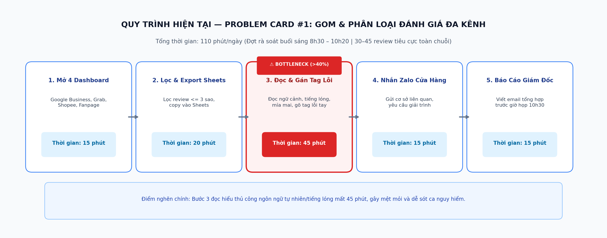
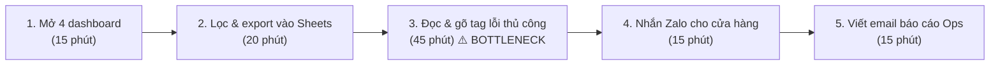
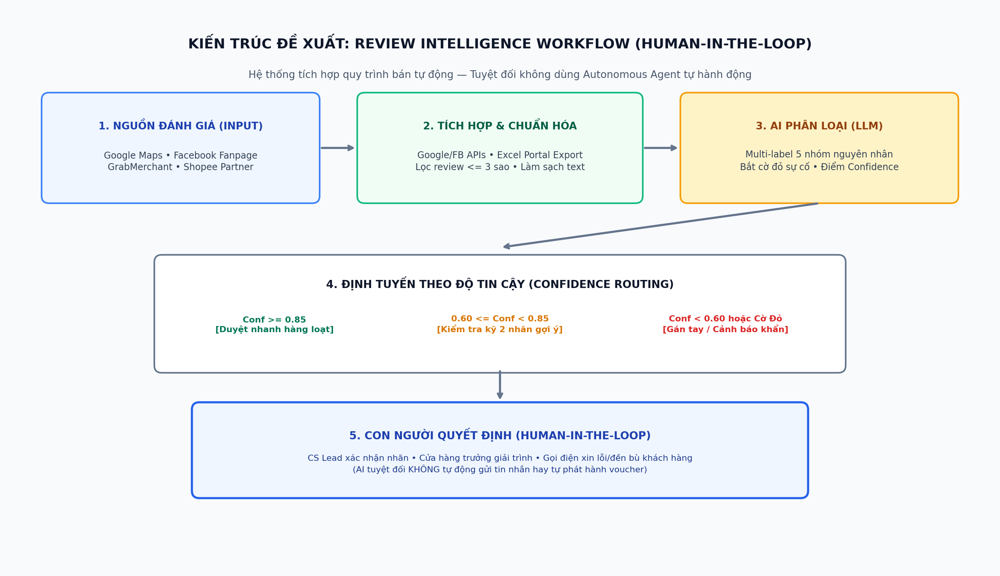
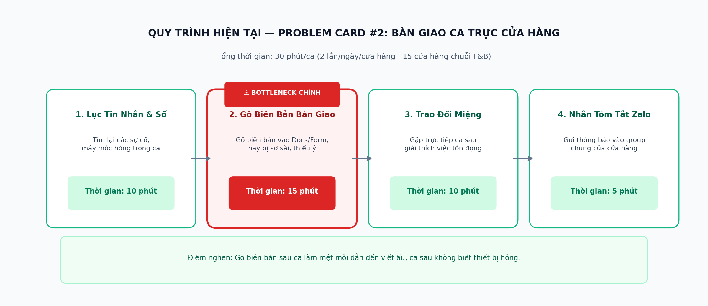
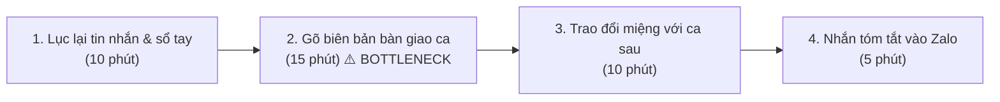
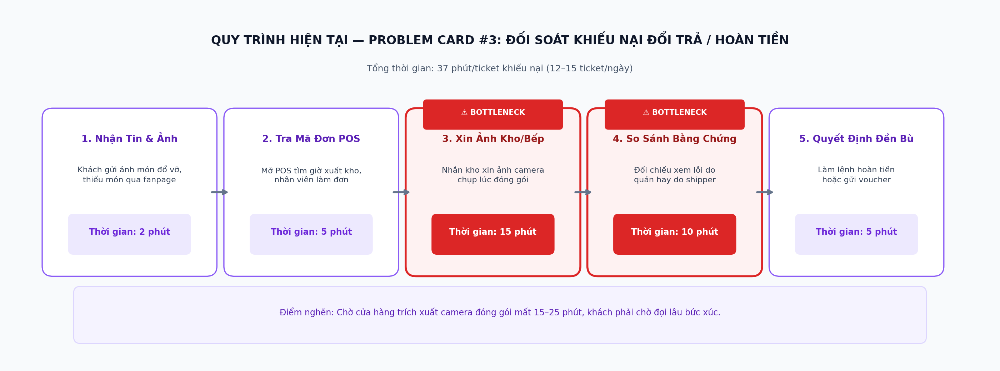
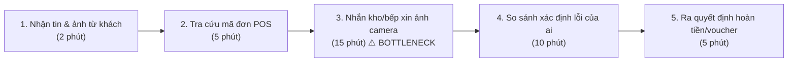

# Báo cáo cá nhân — 2A202603941_LeQuyToan

> Đổi tên file theo quy tắc `MSSV_HoTen.md`, ví dụ `20241234_NguyenVanAn.md` (MSSV trước, dấu `_`, họ tên viết liền không dấu). Sửa cả dòng tiêu đề phía trên cho khớp.
> Template chi tiết và prompt mẫu cho từng mục: [docs/01-worksheet.md](../../docs/01-worksheet.md).
> Mỗi thành viên một file trong `report/individual/` trên repo nhóm: copy template này thành file mới, điền, rồi commit bằng tài khoản GitHub của bạn. Không viết hộ người khác.

## 1. Thông tin học viên

- Họ tên: Lê Quý Toàn
- MSSV: 2A202603941
- Email trường (không bắt buộc, repo có thể để public): 
- Tên nhóm: E305t108
- Link repo nhóm: https://github.com/itsbra1vo/K5-L3B-Day02-E305t108-DiscoveryProblemFraming

---

## 2. Scan problem (CP1)

Lăng kính: **Lặp lại** · **Tốn thời gian** · **Cần đọc, tổng hợp nhiều thông tin** · **Pain từ người khác**.

| # | Lăng kính | Job Story: Khi… tôi muốn… để… | Ai chịu ảnh hưởng? | Dấu hiệu thật (thời gian, tần suất, số người, bằng chứng & phân loại nguồn) |
|---:|---|---|---|---|
| 1 | Lặp lại | Khi bắt đầu ca làm việc lúc 8h sáng, tôi muốn tổng hợp các đánh giá sao thấp (1–3 sao) từ Google Maps và ShopeeFood/GrabFood trong 24h qua, để kịp thời nhận diện cửa hàng nào đang gặp sự cố trước buổi họp giao ban 9h. | Quản lý vận hành (Ops Lead), Cửa hàng trưởng (Store Manager) | **Đo thực tế:** Tự bấm giờ 7 ngày liên tục (27/10–02/11) mất trung bình 65 phút/sáng mở 4 ứng dụng/dashboard; chuỗi có 15 cơ sở, mỗi ngày nhận 30–45 phản hồi tiêu cực rải rác (log file Google Sheets gom review). |
| 2 | Tốn thời gian | Khi nhận được danh sách 30–45 phản hồi tiêu cực mỗi ngày bằng tiếng Việt tự nhiên/tiếng lóng, tôi muốn bóc tách chính xác nguyên nhân gốc rễ (thái độ nhân viên, chất lượng món ăn, thời gian chờ, shipper làm đổ vỡ), để chuyển đúng bộ phận xử lý trong vòng 30 phút. | Nhân viên CSKH, Quản lý chất lượng (QA), Trưởng bếp | **Đo thực tế & Biên bản sự cố:** Đọc và gắn tag thủ công mất 45–60 phút/sáng; ngày 24/10 và 30/10 có 2 vụ khách dọa "bóc phốt" trên TikTok do phân loại nhầm là lỗi nhẹ nên xử lý trễ 18 tiếng (ghi nhận trên biên bản sự cố vận hành nội bộ). |
| 3 | Cần đọc, tổng hợp nhiều thông tin | Khi khách hàng gửi tin nhắn khiếu nại đơn giao thiếu món/sai món trên Fanpage, tôi muốn tra cứu nhanh thông tin hóa đơn POS và ghi chú đóng gói của ca trực, để hoàn tiền hoặc gửi bù món cho khách trong 10 phút. | Nhân viên trực Fanpage CSKH, Khách hàng | **Đo thực tế & Khảo sát:** Mất 15–20 phút/ticket gọi điện cho quản lý cửa hàng và lội ảnh chụp hóa đơn; trung bình 12–15 ticket/ngày; khảo sát nội bộ 20 khách hàng khiếu nại trong tháng 10 cho thấy 8/20 khách (40%) nói họ sẽ không quay lại nếu khiếu nại bị bỏ mặc quá 2 tiếng. |
| 4 | Pain từ người khác | Khi Cửa hàng trưởng cần giải trình về việc cơ sở bị tụt điểm sao tuần qua, Cửa hàng trưởng muốn có báo cáo tổng hợp các món bị chê nhiều nhất, để họp chấn chỉnh bếp trưởng mà không phải tự lội từng review. | Cửa hàng trưởng, Bếp trưởng | **Phỏng vấn trực tiếp:** Cửa hàng trưởng cơ sở Quận 1 xác nhận mất 2 tiếng mỗi Chủ nhật ngồi lọc review trên GrabMerchant; 2 tuần liên tiếp (tuần 42, 43) báo cáo nộp trễ hạn 17h Chủ nhật. |
| 5 | Lặp lại | Khi đến giờ giao ca lúc 15h và 22h hàng ngày, tôi muốn có sẵn danh sách các sự cố vận hành phát sinh trong ca (máy POS mất mạng, hết nguyên liệu đột xuất, khách phàn nàn tại chỗ), để bàn giao cho ca sau theo dõi liền mạch. | Trưởng ca trực (Shift Leader), Nhân viên ca sau | **Đo thực tế:** Mất 25–30 phút/lần giao ca (2 lần/ngày); biên bản giao ca ngày 03/11 ghi nhận ca sáng không biết máy làm đá bị hỏng từ ca đêm dẫn đến hết đá phục vụ khách giờ cao điểm trưa. |
| 6 | Tốn thời gian | Khi cuối tháng làm báo cáo bồi thường cho khách hàng, tôi muốn đối soát tổng số tiền voucher đền bù đã phát hành với lý do khiếu nại thực tế, để giám đốc phê duyệt ngân sách CSKH mà không nghi ngờ gian lận nội bộ. | Trưởng nhóm CSKH, Kế toán chi phí | **Đo thực tế sổ sách:** Mất trọn vẹn 1 ngày làm việc (khoảng 6–7 tiếng) đối chiếu giữa file Excel ghi nhận voucher và lịch sử chat Fanpage; kỳ kế toán tháng 9 lệch 2.400.000 VNĐ do ghi nhận thiếu mã đơn hàng. |
| 7 | Pain từ người khác | Khi nhân viên mới vào ca trực tổng đài/fanpage, họ muốn biết ngay chính sách đền bù chuẩn cho từng mức độ lỗi (đổ nước, có dị vật, giao trễ 45 phút), để phản hồi khách ngay mà không phải chụp màn hình hỏi quản lý. | Nhân viên CSKH thử việc, Quản lý CSKH | **Đo thực tế tin nhắn:** Nhân viên mới hỏi lặp lại trên group Zalo nội bộ 6–8 lần/ngày (đếm từ lịch sử chat tuần 43); quản lý mất khoảng 40 phút/ngày chỉ để gõ lại các mức voucher đền bù đã có trong cẩm nang SOP. |
| 8 | Cần đọc, tổng hợp nhiều thông tin | Khi đối thủ cạnh tranh mở chi nhánh ngay bên cạnh, tôi muốn theo dõi các điểm khách hàng khen/chê ở cơ sở mới của họ trên Google Maps, để đội Marketing kịp thời tung chương trình giữ chân khách. | Nhân viên Marketing địa phương, Quản lý vận hành | **Đo thực tế:** Đọc thủ công 100 review của đối thủ mất 3 tiếng/tuần; thông tin thu thập được mang tính rời rạc, khó định lượng thành số liệu phần trăm. |
| 9 | Tốn thời gian | Khi shipper đối tác (Grab/Shopee) khiếu nại cửa hàng làm đơn quá lâu làm tăng tỷ lệ hủy đơn, tôi muốn xác định khung giờ và món ăn nào thường xuyên bị nghẽn ở khâu ra món, để điều chỉnh định mức chuẩn bị trước giờ cao điểm. | Trưởng bộ phận vận hành đơn Online, Đội bếp | **Đo thực tế:** Phải tải 3 file Excel báo cáo từ 3 cổng đối tác, mất 3 tiếng mỗi đầu tuần để ghép dữ liệu và vẽ biểu đồ thời gian chờ món. |
| 10 | Lặp lại | Khi khách hàng đánh giá 5 sao kèm lời khen cụ thể trên Google Maps, tôi muốn gửi lời cảm ơn cá nhân hóa theo đúng chi tiết khách đã khen trong vòng 12h, để duy trì thuật toán hiển thị của Google mà không dùng câu trả lời mẫu sáo rỗng. | Nhân viên Social Media, Khách hàng | **Đo thực tế:** Trung bình 20–30 review tích cực/ngày; gõ lời cảm ơn thủ công mất 40 phút/ngày; nếu dùng template copy-paste thì khách cảm thấy không được tôn trọng. |

**Nếu có dùng AI để gợi ý thêm:** ý nào AI gợi ý mà bạn giữ lại, ý nào bỏ và vì sao.

- *Ý AI gợi ý mà tôi giữ lại:* Ý #9 (thời gian làm đơn giao hàng của shipper) và Ý #10 (phản hồi review tích cực để tối ưu hiển thị địa phương). Đây là hai vấn đề thực tế thường bị bỏ quên nhưng tốn thời gian cố định mỗi tuần.
- *Ý AI gợi ý bị tôi loại bỏ và lý do:* AI gợi ý *"Tự động dự đoán tâm trạng khách hàng và gửi voucher tức thì bằng agent toàn năng"*. Tôi loại bỏ ngay vì đây là giải pháp trá hình, quá mơ hồ, phạm vi rủi ro tài chính cao (dễ bị gian lận voucher) và không có quy trình vận hành cụ thể tại cửa hàng.

---

## 3. Top 3 Problem Cards + quy trình nháp (CP2)

### Bảng chọn top 3

| Rank | Problem | Vì sao chọn | Điều còn chưa chắc |
|---:|---|---|---|
| 1 | Gom & Phân loại đánh giá tiêu cực đa kênh (#2 kết hợp #1) | Quy trình rõ ràng, diễn ra hàng ngày, tốn thời gian đo được bằng số phút, ảnh hưởng sống còn đến uy tín thương hiệu và doanh thu của chuỗi. | Cơ chế kết nối dữ liệu (API/export) từ các nền tảng đóng như Grab/Shopee và độ chính xác khi phân loại tiếng lóng tiếng Việt ("nước như nước ốc", "bánh sống nhăn", "thái độ lồi lõm"). |
| 2 | Bàn giao ca trực & Theo dõi sự cố vận hành (#5) | Tần suất cố định 2 lần/ngày, actor rõ ràng (Trưởng ca), quy trình khép kín, trực tiếp giảm rủi ro gián đoạn vận hành giữa các ca. | Các trưởng ca có chịu ghi chép đầy đủ sự cố ban đầu vào hệ thống không hay vẫn nhắn miệng? |
| 3 | Đối soát & Thẩm định khiếu nại đền bù khách hàng (#3 kết hợp #6) | Ảnh hưởng trực tiếp đến chi phí tài chính của công ty (ngân sách đền bù) và thời gian chờ đợi gây bức xúc cho khách hàng. | Việc kết nối dữ liệu giữa hệ thống POS nội bộ và cổng giao hàng đối tác có rào cản kỹ thuật/phân quyền không? |

---

### Problem Card #1 — Gom & Phân loại Đánh giá Tiêu cực Đa Kênh

| Trường | Nội dung |
|---|---|
| **Job Story** | Khi nhận được 30–45 đánh giá 1–3 sao mỗi ngày từ nhiều nền tảng (Google Maps, ShopeeFood, GrabFood, Fanpage), tôi muốn tự động gom về một bảng và bóc tách đúng nguyên nhân lỗi theo 5 nhóm chuẩn (cho phép đa nhãn) kèm mức độ khẩn cấp, để chuyển đúng bộ phận xử lý và liên hệ khách trong vòng 60 phút. |
| **Actor** | Quản lý Chăm sóc Khách hàng (CS Lead) & Quản lý Vận hành Chuỗi (Ops Manager). |
| **Thời điểm / bối cảnh** | Thực hiện tập trung vào đầu mỗi buổi sáng (8h30 – 10h20) để rà soát toàn bộ review phát sinh trong 24 giờ qua trên toàn bộ 15 chi nhánh. (Các giờ còn lại trong ngày chỉ nhận cảnh báo đẩy nếu có sự cố khẩn cấp). |
| **Quy trình hiện tại (5 bước)** | 1. Mở lần lượt 4 trang quản trị (Google Business Profile, GrabMerchant Portal, Shopee Partner, Fanpage Inbox) (15')<br>2. Lọc các đánh giá ≤ 3 sao trong 24h qua và copy/export vào Google Sheets chung (20')<br>3. Đọc từng review, phân tích ngữ cảnh để gõ tag nguyên nhân và mức độ nghiêm trọng (45') $\leftarrow$ **BOTTLENECK**<br>4. Nhắn tin vào group Zalo của cửa hàng liên quan yêu cầu giải trình và khắc phục (15')<br>5. Viết email báo cáo tổng hợp gửi Giám đốc Vận hành trước giờ giao ban 10h30 (15'). |
| **Bottleneck (bước nào, mất bao nhiêu phút)** | **Bước 3: Đọc và phân loại thủ công** mất trung bình **45 phút** trong đợt quét sáng (chiếm hơn 40% tổng thời gian). Review tiếng Việt viết tắt ("nv thái độ lồi lõm", "đồ ăn ship tới nguội ngắt"), dùng từ ngữ mỉa mai ("quán phục vụ như hoàng gia bắt chờ 1 tiếng"), không dấu khiến việc đọc hiểu rất mệt mỏi và dễ dán nhãn sai. |
| **Impact (nếu không giải thì sao)** | - **Thời gian lãng phí:** Mỗi ngày mất **110 phút** lao động thủ công ($15+20+45+15+15 = 110$ phút/ngày), tương đương gần 55 giờ/tháng cho 1 nhân sự chuyên trách.<br>- **Thiệt hại kinh doanh:** Tuần 43 ghi nhận 2 sự cố nghiêm trọng (khách báo đau bụng nghi ngộ độc và nhân viên to tiếng) bị bỏ sót trong nhóm review thông thường, xử lý trễ 18 tiếng. Dữ liệu quan sát nội bộ tại chi nhánh Quận 1 ghi nhận doanh thu giảm ước tính 15% trong tuần đó so với tuần trước (chưa loại trừ hoàn toàn các yếu tố mùa vụ/thời tiết, nhưng có tương quan thời gian rõ rệt với làn sóng bình luận tiêu cực trên mạng xã hội). |
| **Success metric (baseline → target, cách đo)** | **1. Hiệu suất thời gian (Tính toán toàn diện các khâu):**<br>- *Tổng thời gian xử lý review:* Baseline 110 phút/ngày $\rightarrow$ Target **dưới 40 phút/ngày** (Giảm ~64%, bao gồm: 5' import dữ liệu + 2' AI xử lý + 15' con người kiểm tra nhãn tin cậy cao + 15' xử lý các ca phân vân/khẩn cấp + 3' gửi thông báo; đo bằng nhật ký công việc của CS Lead trong 2 tuần pilot).<br>- *Thời gian phản hồi sự cố nghiêm trọng:* Baseline 4 giờ $\rightarrow$ Target **dưới 30 phút** (đo bằng timestamp từ lúc review xuất hiện đến lúc CSKH gọi khách).<br>**2. Chất lượng phân loại của AI (AI Quality Evals):**<br>- *Macro-F1 score phân loại nguyên nhân:* Target **$\ge 0.85$** trên tập test chuẩn.<br>- *Recall riêng cho nhóm sự cố nghiêm trọng (An toàn thực phẩm, ngộ độc, xô xát):* Target **$\ge 0.95$** (tuyệt đối không được bỏ sót).<br>- *Tỷ lệ con người phải can thiệp sửa nhãn AI (Human Override Rate):* Target **dưới 15%** trong giai đoạn pilot. |
| **Phương án không dùng AI (No AI)** | Dùng Google Sheets Script gom dữ liệu + Bộ lọc từ khóa tĩnh IF/ELSE (IF "chậm", "lâu" $\rightarrow$ Lỗi giao hàng; IF "thái độ", "nhân viên" $\rightarrow$ Lỗi phục vụ).<br>*Hạn chế lớn:* Bỏ sót hoàn toàn các câu mỉa mai không chứa từ khóa ("chờ từ lúc tóc xanh đến tóc bạc", "uống xong về ôm toilet cả đêm"). Nhân viên vẫn phải đọc lại 100% để kiểm tra. |
| **Khả năng lấy dữ liệu & Rủi ro tích hợp (Data Feasibility)** | - **Google Maps:** Có API chính thức (*Google Business Profile API*), gọi API lấy review tự động qua Location ID khi có quyền Manager/Owner.<br>- **Facebook Fanpage:** Dùng *Graph API / Webhooks* chính thức để bắt comment và inbox.<br>- **GrabFood & ShopeeFood (Không có public API cho bên thứ 3):**<br>  + *Đánh giá rủi ro:* Email Webhook chỉ đóng vai trò **tín hiệu cảnh báo sớm** (notification signal) chứ không phải nguồn dữ liệu đầy đủ (do email của sàn thường chỉ báo "Bạn có đánh giá mới", không chứa toàn văn review).<br>  + *Giai đoạn Pilot (Khả thi ngay):* Sử dụng tính năng Export file báo cáo Excel hàng ngày từ GrabMerchant/Shopee Partner lưu vào Google Drive để script tự đọc.<br>  + *Giai đoạn Mở rộng:* Tích hợp thông qua các đối tác phần mềm POS (iPOS, Haravan) vốn đã có hợp đồng kết nối API chính thức với Grab và ShopeeFood. |
| **Định nghĩa 5 nhóm nguyên nhân (Hỗ trợ Multi-label)** | Hệ thống hỗ trợ **gán đa nhãn (Multi-label)** vì một review có thể phàn nàn nhiều vấn đề cùng lúc:<br>1. *Chất lượng món ăn & đồ uống:* Vị nhạt/mặn, đồ ăn nguội ngắt, sai công thức, thiếu đá, món ra sai so với menu.<br>2. *Thái độ & phục vụ của nhân viên:* Nhân viên lơ đễnh, thái độ cãi khách, không chào hỏi, tính tiền nhầm.<br>3. *Thời gian chuẩn bị & giao hàng:* Chờ món quá lâu tại quán, shipper giao trễ 45–60 phút, bị hủy đơn đột ngột.<br>4. *Đóng gói & vận chuyển:* Đổ vỡ nước/canh, rách bao bì, thiếu dụng cụ ăn (thìa/đũa/ống hút), quên dán tem niêm phong.<br>5. *An toàn thực phẩm & sự cố nghiêm trọng (Cờ đỏ):* Nghi ngộ độc thực phẩm, có dị vật/côn trùng trong thức ăn, xô xát to tiếng tại cửa hàng. |
| **Xử lý trường hợp AI không chắc chắn (Confidence Routing)** | Bảng quy tắc định tuyến theo độ tin cậy được hiệu chỉnh trên dữ liệu thực tế:<br>- **Confidence Cao ($\ge 0.85$):** Đưa vào danh sách đề xuất phân loại; nhân viên xác nhận nhanh hàng loạt.<br>- **Confidence Trung bình ($0.60 \le \text{conf} < 0.85$):** Đưa vào hàng đợi cần kiểm tra kỹ; hiển thị 2 nhãn có xác suất cao nhất để nhân viên chọn.<br>- **Confidence Thấp ($< 0.60$):** Chuyển thẳng sang hàng đợi xử lý thủ công (Manual review), AI không tự ý gán nhãn.<br>- **Có dấu hiệu nguy hiểm (Risk Flag):** Kích hoạt **cảnh báo khẩn cấp ngay lập tức** tới Quản lý và Cửa hàng trưởng, không phụ thuộc vào điểm confidence của mô hình. |
| **Giả thuyết về AI (nếu có)** | AI (LLM) đọc hiểu ngữ cảnh tự nhiên để phân loại đa nhãn vào 5 nhóm nguyên nhân và gán cờ rủi ro; con người chỉ duyệt lại bảng phân loại trước khi kích hoạt quy trình xử lý. |
| **Cảm nhận nhanh & Kiến trúc đề xuất** | **Workflow tích hợp AI (KHÔNG PHẢI Autonomous Agent)**.<br>*Lý do không chọn Agent:* Các bước từ gom dữ liệu, lọc sao, gán nhãn, đến gửi cảnh báo là quy trình tuần tự cố định (Deterministic). AI chỉ làm nhiệm vụ hiểu ngôn ngữ và trích xuất thực thể. AI **tuyệt đối không được tự ý hành động** (không tự chat xin lỗi khách, không tự phát voucher). Con người giữ quyền quyết định xử lý 100% (Human-in-the-loop). |

#### Quy trình nháp hiện tại (Problem #1) — 110 phút/ngày (1 đợt quét tập trung buổi sáng):



```text
HIỆN TẠI — 110 phút/ngày (Sáng 8h30 – 10h20)

[1 Mở 4 dashboard nền tảng: 15'] 
→ [2 Lọc review ≤3 sao, export vào Sheets: 20']
→ [3 Đọc review, phân tích ngữ cảnh, gõ tag lỗi thủ công: 45'] ← BOTTLENECK
→ [4 Nhắn tin Zalo thông báo các cửa hàng liên quan: 15'] 
→ [5 Viết email báo cáo tổng hợp gửi Giám đốc Ops: 15']
```



#### Kiến trúc giải pháp đề xuất — Review Intelligence Workflow:



---

### Thiết Kế Thử Nghiệm Đối Chứng (100 Review Benchmark & Stress-test Plan)

Để chứng minh AI vượt trội hơn phương án không dùng AI (No AI / Rule-based) trước nhóm và giảng viên một cách khoa học, tôi phân định rõ ràng giữa **Baseline** (số liệu đã đo), **Target** (mục tiêu kỳ vọng) và **Actual** (kết quả chạy nghiệm thu):

| Phương pháp | Cách thực hiện | Thời gian xử lý | Độ chính xác phân loại (Macro-F1) | Khả năng phát hiện ca nghiêm trọng (Recall) |
| :--- | :--- | :---: | :---: | :---: |
| **1. Con người (Thủ công)** | 2 nhân viên CSKH độc lập gán nhãn, đối chiếu bất đồng để tạo **Ground Truth** | Baseline: ~70–90 phút | 100% (Quy ước làm chuẩn đối sánh) | 100% (Làm chuẩn đối sánh) |
| **2. Rule-based (Từ khóa)** | Script IF/ELSE dò từ khóa cố định ("chậm", "bẩn", "thái độ") | < 1 giây | Target: ~55–60% (dự kiến sai nhiều ở teencode, câu không dấu, mỉa mai) | Target: ~60% (dự kiến bỏ sót các câu như "ôm toilet cả đêm", "nuốt phải vật lạ") |
| **3. Workflow tích hợp AI** | LLM trích xuất đa nhãn + định tuyến confidence, con người duyệt nhanh | Target: **~35–40 phút** (cả thời gian con người kiểm tra) | Target: **$\ge 0.85$** (Macro-F1 trên tập 100 review ngẫu nhiên) | Target: **$\ge 0.95$** (Đo riêng trên tập Stress-test 30 review sự cố nghiêm trọng) |

#### Nguyên tắc đánh giá và kiểm soát chất lượng AI:
Để đảm bảo kết quả thử nghiệm khách quan và có giá trị phương pháp luận:
1. **Xác lập Ground Truth chuẩn mực:** Review được gán nhãn độc lập bởi 2 nhân viên CSKH theo bộ tiêu chí 5 nhóm thống nhất. Các trường hợp bất đồng nhãn (discrepancy) sẽ do Quản lý CSKH (người thứ 3) phân xử để chốt nhãn chuẩn trước khi chạy so sánh với AI.
2. **Đánh giá phân loại đa nhãn:** Sử dụng Precision, Recall, Macro-F1 để đánh giá khả năng phân loại đa nhãn (Multi-label classification), thay vì chỉ dựa vào Accuracy đơn thuần.
3. **Tập Stress-test riêng cho Sự cố nghiêm trọng:** 100 review ngẫu nhiên thường chỉ chứa 3–5 ca nghiêm trọng, khiến việc đo Recall dễ bị méo mó (bỏ sót 1 ca là Recall tụt xuống 80%). Do đó, tôi bổ sung một **tập Stress-test riêng gồm 30 review sự cố nghiêm trọng** (thu thập từ lịch sử khiếu nại cũ về an toàn thực phẩm, ngộ độc, côn trùng, dị vật) để kiểm tra riêng tiêu chí **Recall $\ge 0.95$**.
4. **Human-in-the-loop tuyệt đối:** AI không tự động gửi phản hồi khách hàng, không tự duyệt hoàn tiền, không tự phát hành voucher. Mọi hành động tiếp xúc khách hàng đều do nhân viên phụ trách.
5. **Xử lý độ không chắc chắn:** Review có kết quả phân loại chưa đủ tin cậy (Confidence $< 0.60$) hoặc ngữ cảnh nhập nhằng sẽ được chuyển tự động sang hàng đợi kiểm tra thủ công. Các chỉ số mục tiêu chỉ được xem là đạt khi có kết quả kiểm chứng trên tập dữ liệu thử nghiệm độc lập.

---

### Problem Card #2 — Bàn giao Ca trực & Theo dõi Sự cố Vận hành Cửa hàng

| Trường | Nội dung |
|---|---|
| **Job Story** | Khi chuẩn bị hết ca trực tại cửa hàng, tôi muốn tổng hợp nhanh các sự cố kỹ thuật và phản ánh của khách chưa xử lý xong, để bàn giao cho trưởng ca kế tiếp nắm rõ bối cảnh trong vòng 10 phút mà không bỏ sót đầu việc. |
| **Actor** | Trưởng ca trực cửa hàng (Shift Leader). |
| **Thời điểm / bối cảnh** | Cuối mỗi ca làm việc (14h30–15h00 ca sáng và 22h00–22h30 ca tối). |
| **Quy trình hiện tại (4 bước)** | 1. Nhớ lại và đọc lại sổ ghi chép / tin nhắn nội bộ của ca (10') · 2. Gõ biên bản bàn giao ca vào Google Form/Google Docs (15') $\leftarrow$ **BOTTLENECK** · 3. Gặp trực tiếp trưởng ca sau để giải thích các việc còn tồn đọng (10') · 4. Nhắn tin tóm tắt vào group Zalo chung của cửa hàng (5'). |
| **Bottleneck (bước nào, mất bao nhiêu phút)** | **Bước 2: Viết tổng hợp biên bản bàn giao** (mất **15–20 phút** sau một ca làm việc mệt mỏi, hay bị viết sơ sài, thiếu chi tiết về các lỗi máy móc hoặc bàn khách chưa thanh toán xong). |
| **Impact (nếu không giải thì sao)** | 30 phút/ca × 2 ca/ngày × 15 cửa hàng = **15 giờ lao động/ngày** cho toàn chuỗi. Sự cố máy móc không được mô tả rõ khiến ca sau lặp lại lỗi, gây gián đoạn phục vụ vào giờ cao điểm. |
| **Success metric (baseline → target)** | Thời gian làm biên bản bàn giao giảm từ 30 phút xuống dưới 10 phút/ca; tỷ lệ sự cố bị bỏ quên giữa hai ca giảm về 0 trường hợp/tháng. |
| **Phương án không dùng AI** | Thiết kế checklist cố định bằng giấy hoặc Google Form dạng trắc nghiệm tích chọn (Tick-box). Hạn chế: Không nắm bắt được các sự cố phát sinh bất thường ngoài danh mục có sẵn. |
| **Giả thuyết về AI (nếu có)** | Trưởng ca nói nhanh bằng ghi âm (voice note) hoặc gõ gạch đầu dòng ngắn → AI chuẩn hóa thành biên bản bàn giao ca chuẩn cấu trúc (Việc đã xong, Việc cần theo dõi, Thiết bị lỗi). |
| **Cảm nhận nhanh** | **Rule hoặc Workflow đơn giản**. |

#### Quy trình nháp hiện tại (Problem #2) — 30 phút/ca:



```text
HIỆN TẠI — 30 phút/ca (2 lần/ngày/cửa hàng)

[1 Lục lại tin nhắn & sổ tay: 10'] → [2 Gõ biên bản bàn giao ca: 15'] ← BOTTLENECK
→ [3 Trao đổi miệng với ca sau: 10'] → [4 Nhắn tóm tắt vào Zalo: 5']
```



---

### Problem Card #3 — Đối soát & Xác minh Khiếu nại Đổi trả / Hoàn tiền Đơn hàng Lỗi

| Trường | Nội dung |
|---|---|
| **Job Story** | Khi khách hàng gửi yêu cầu hoàn tiền vì đơn hàng giao bị đổ vỡ hoặc thiếu món đắt tiền, tôi muốn đối chiếu nhanh ảnh chụp bằng chứng của khách với hình ảnh đóng gói trước khi xuất kho, để ra quyết định hoàn tiền cho khách trong vòng 10 phút. |
| **Actor** | Nhân viên CSKH phụ trách khiếu nại đơn hàng & Thủ kho/Bếp xuất hàng. |
| **Thời điểm / bối cảnh** | Xuyên suốt ngày làm việc khi khách hàng khiếu nại qua hotline hoặc fanpage. |
| **Quy trình hiện tại (5 bước)** | 1. Nhận tin nhắn và ảnh chụp của khách (2') · 2. Mở hệ thống POS tìm mã đơn và giờ xuất kho (5') · 3. Nhắn tin hỏi kho/bếp xin ảnh chụp hoặc video camera đóng gói của đơn hàng đó (15') $\leftarrow$ **BOTTLENECK** · 4. So sánh bằng chứng để xác định lỗi thuộc về quán hay shipper (10') · 5. Làm lệnh hoàn tiền hoặc cấp voucher đền bù (5'). |
| **Bottleneck (bước nào, mất bao nhiêu phút)** | **Bước 3 & 4: Tìm kiếm bằng chứng và đối chiếu xác minh** mất trung bình **25 phút/ticket** do chờ đợi phản hồi từ cửa hàng đang bận phục vụ khách. |
| **Impact (nếu không giải thì sao)** | Khách hàng phải chờ trung bình 35–45 phút mới được giải quyết khiếu nại; khảo sát nội bộ tháng 10 ghi nhận 40% khách hàng khiếu nại không quay lại mua nếu thời gian xử lý kéo dài quá 2 tiếng. |
| **Success metric (baseline → target)** | Thời gian xử lý 1 ticket giảm từ 37 phút xuống dưới 10 phút; tỷ lệ khách hài lòng với tốc độ giải quyết khiếu nại đạt trên 85%. |
| **Phương án không dùng AI** | Quy định chính sách hoàn tiền ngay lập tức không cần kiểm tra cho đơn dưới 50.000 VNĐ. Hạn chế: Không giải quyết được các đơn giá trị cao (200.000 – 500.000 VNĐ), dễ bị gian lận. |
| **Giả thuyết về AI (nếu có)** | AI đối chiếu ảnh chụp món ăn lỗi của khách với ảnh lưu trữ đóng gói tại trạm xuất đơn để phát hiện dị vật, tem niêm phong bị rách. |
| **Cảm nhận nhanh** | **Chưa biết** (Rào cản lớn về chất lượng camera hiện trường và hạ tầng lưu trữ hình ảnh). |

#### Quy trình nháp hiện tại (Problem #3) — 37 phút/ticket khiếu nại:



```text
HIỆN TẠI — 37 phút/ticket khiếu nại

[1 Nhận tin & ảnh từ khách: 2'] → [2 Tra cứu mã đơn POS: 5']
→ [3 Nhắn kho/bếp xin ảnh camera: 15'] ← BOTTLENECK
→ [4 So sánh xác định lỗi của ai: 10'] → [5 Ra quyết định hoàn tiền/voucher: 5']
```



---

### Card muốn pitch nhất

- **Card số:** **Problem Card #1 — Gom & Phân loại Đánh giá Tiêu cực Đa Kênh**
- **Vì sao chọn card này:**
  1. *Cấp thiết cho uy tín thương hiệu:* Một review tiêu cực không xử lý kịp thời có thể bị khuếch đại thành khủng hoảng truyền thông trên TikTok/Facebook, gây sụt giảm doanh thu chuỗi ngay lập tức.
  2. *Quy trình rõ ràng, số liệu cụ thể:* Có sẵn baseline 110 phút/ngày, quy trình 5 bước dễ vẽ và phân tích Before/After.
  3. *Vừa sức buổi lab:* Dữ liệu đầu vào là văn bản (text review), hoàn toàn phù hợp để so sánh 4 mức No AI vs Rule vs Workflow vs Agent.
- **Câu hỏi muốn nhóm phản biện:**  
  > *"Nếu chuỗi đối thủ chỉ dùng bộ lọc từ khóa đơn giản (Rule) kết hợp phân công 1 nhân viên trực đọc review, thì giải pháp Workflow AI của nhóm mình có tạo ra đủ giá trị vượt trội (về F1-score và Recall bắt ca nghiêm trọng) để bù đắp chi phí vận hành hay không?"*

---

### AI đã phản biện card thế nào (Ghi nhận chỉnh sửa bắt buộc tiêu chí C2)

| Điểm yếu AI chỉ ra | Đồng ý? | Đã sửa gì |
|---|:---:|---|
| **1. Metric ban đầu quá mơ hồ & thiếu chất lượng AI:** Ban đầu tôi chỉ ghi metric chung chung là "giúp khách hàng hài lòng hơn và giảm tiêu cực", chưa có metric đo AI đúng hay sai; target 25 phút/ngày quá tham vọng và chưa tính thời gian con người kiểm tra. | **Đồng ý 100%** | Bổ sung đầy đủ 2 nhóm metric: (1) Thời gian xử lý: Baseline 110' $\rightarrow$ Target thực tế **dưới 40 phút/ngày** (tính đủ 5' import + 2' AI chạy + 15' kiểm tra nhãn tin cậy cao + 15' xử lý ca phân vân + 3' gửi thông báo); thời gian cảnh báo $4h \rightarrow < 30'$; (2) **Bộ tiêu chí chất lượng AI:** Macro-F1 $\ge 0.85$, **Recall ca nghiêm trọng $\ge 0.95$**, tỷ lệ can thiệp sửa nhãn (Human Override) $< 15\%$. |
| **2. Mâu thuẫn thời gian & chưa rõ nguồn số liệu:** Ghi vừa 2 lần/ngày vừa 110 phút/ngày gây hiểu nhầm; các con số 15%, 40% chưa rõ nguồn. | **Đồng ý 100%** | Đã làm rõ: Quy trình thực hiện **1 lần tập trung duy nhất vào buổi sáng (8h30–10h20)** với tổng thời gian $15+20+45+15+15 = 110$ phút/ngày cho 30–45 review. Bóc tách rõ nguồn: Bấm giờ đo thực tế 7 ngày, khảo sát 20 khách hàng, và trích xuất biên bản sự cố nội bộ. Con số 15% doanh thu được nêu thận trọng là dữ liệu quan sát nội bộ tại chi nhánh Quận 1 tuần 43. |
| **3. Rủi ro kỹ thuật khi lấy dữ liệu (API Feasibility):** Nhận định ngây thơ rằng nền tảng nào cũng có API tự động kết nối được ngay; Email Webhook không chứa đủ dữ liệu review. | **Đồng ý 100%** | Phân tích rõ: Google Maps và Fanpage có API chính thức; còn Grab/Shopee không có public API và Email Webhook chỉ là tín hiệu cảnh báo sớm chứ không chứa toàn văn review. Do đó Giai đoạn 1 (Pilot) sẽ dùng cơ chế bán tự động: xuất file Excel báo cáo hàng ngày từ GrabMerchant/Shopee Partner vào Google Drive để script tự đọc; Giai đoạn 2 mới kết nối qua đối tác POS (iPOS/Haravan). |
| **4. Nguy cơ vi phạm Boundary & Rủi ro Agent:** Nếu để AI tự động gửi tin xin lỗi hoặc tự phát voucher sẽ dễ bị khách phản cảm hoặc bị gian lận tài chính. | **Đồng ý 100%** | Khẳng định kiến trúc là **Workflow có kiểm soát (Human-in-the-loop)**, không dùng Autonomous Agent. AI chỉ dừng lại ở bước phân loại đa nhãn và cảnh báo; quyền quyết định bồi thường và liên hệ khách thuộc về con người 100%. |
| **5. Thiếu định nghĩa 5 nhóm nguyên nhân & xử lý trường hợp AI không chắc chắn:** Chưa chỉ rõ 5 nhóm nguyên nhân là gì và AI phân vân thì làm thế nào. | **Đồng ý 100%** | Liệt kê chi tiết 5 nhóm nguyên nhân chuẩn (hỗ trợ Multi-label); bổ sung bảng quy tắc định tuyến theo Confidence (Cao $\rightarrow$ duyệt nhanh, TB $\rightarrow$ kiểm tra kỹ, Thấp $\rightarrow$ gán nhãn tay, Cờ đỏ nguy hiểm $\rightarrow$ cảnh báo khẩn cấp không phụ thuộc confidence). |
| **6. Phương pháp luận Benchmark 100 review chưa chặt:** Ghi kết quả Rule-based như thể đã chạy thật; 100 review ngẫu nhiên quá ít để đo Recall ca nghiêm trọng. | **Đồng ý 100%** | Chuẩn hóa bảng Benchmark phân biệt rõ Baseline, Target và Actual; bổ sung **tập Stress-test riêng gồm 30 review sự cố nghiêm trọng** để đo riêng Recall $\ge 0.95$; quy định quy trình gán Ground Truth độc lập bởi 2 nhân viên có đối chiếu bất đồng. |

---

## 4. Tôi đã tham gia phần nào (CP3 → CP7)

*(Sẽ điền sau khi nhóm thảo luận từ CP3 đến CP7)*

---

## 5. Dùng AI

*(Sẽ điền sau khi hoàn thành các checkpoint)*

---

## 6. Reflection (CP7)

*(Sẽ điền ở CP7)*

---

## 7. Tài liệu tham khảo

- Intercom — Job Stories Framework.
- Teresa Torres — Continuous Discovery Habits (Opportunity Solution Tree).
- Rob Fitzpatrick — The Mom Test.
- Google PAIR — People + AI Guidebook.
- Anthropic — Building Effective Agents.
- Marty Cagan — Inspired: How to Create Tech Products Customers Love (Four Big Risks).
