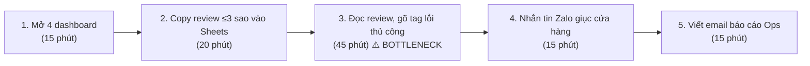
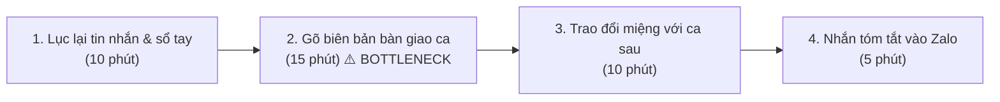
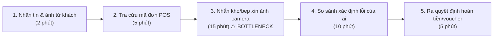

# Báo cáo cá nhân — 2A202603941_LeQuyToan

> Đổi tên file theo quy tắc `MSSV_HoTen.md`, ví dụ `20241234_NguyenVanAn.md` (MSSV trước, dấu `_`, họ tên viết liền không dấu). Sửa cả dòng tiêu đề phía trên cho khớp.
> Template chi tiết và prompt mẫu cho từng mục: [docs/01-worksheet.md](../../docs/01-worksheet.md).
> Mỗi thành viên một file trong `report/individual/` trên repo nhóm: copy template này thành file mới, điền, rồi commit bằng tài khoản GitHub của bạn. Không viết hộ người khác.

## 1. Thông tin học viên

- Họ tên: Lê Quý Toàn
- MSSV: 2A202603941
- Email trường (không bắt buộc, repo có thể để public): 
- Tên nhóm: E305t108
- Link repo nhóm: https://github.com/itsbra1vo/K5-L3B-Day02-E305t108-DiscoveryProblemFraming

---

## 2. Scan problem (CP1)

Lăng kính: **Lặp lại** · **Tốn thời gian** · **Cần đọc, tổng hợp nhiều thông tin** · **Pain từ người khác**.

| # | Lăng kính | Job Story: Khi… tôi muốn… để… | Ai chịu ảnh hưởng? | Dấu hiệu thật (thời gian, tần suất, số người, bằng chứng) |
|---:|---|---|---|---|
| 1 | Lặp lại | Khi bắt đầu ca làm việc lúc 8h sáng, tôi muốn tổng hợp các đánh giá sao thấp (1–3 sao) từ Google Maps và ShopeeFood/GrabFood trong 24h qua, để kịp thời nhận diện cửa hàng nào đang gặp sự cố trước buổi họp giao ban 9h. | Quản lý vận hành (Ops Lead), Cửa hàng trưởng (Store Manager) | Bấm giờ thực tế 7 ngày gần nhất: mất trung bình 65 phút/sáng mở 4 ứng dụng/dashboard; chuỗi có 15 cơ sở, mỗi ngày nhận 30–45 phản hồi tiêu cực rải rác. |
| 2 | Tốn thời gian | Khi nhận được danh sách 40–50 phản hồi tiêu cực mỗi ngày bằng tiếng Việt tự nhiên/tiếng lóng, tôi muốn bóc tách chính xác nguyên nhân gốc rễ (thái độ nhân viên, chất lượng món ăn, thời gian chờ, shipper làm đổ vỡ), để chuyển đúng bộ phận xử lý trong vòng 30 phút. | Nhân viên CSKH, Quản lý chất lượng (QA), Trưởng bếp | Đọc và gắn tag thủ công mất 70–90 phút/ngày; tuần trước có 3 vụ khách dọa "bóc phốt" trên TikTok do phân loại nhầm là lỗi nhẹ nên xử lý trễ 18 tiếng (ghi nhận trên group Zalo nội bộ). |
| 3 | Cần đọc, tổng hợp nhiều thông tin | Khi khách hàng gửi tin nhắn khiếu nại đơn giao thiếu món/sai món trên Fanpage, tôi muốn tra cứu nhanh thông tin hóa đơn POS và ghi chú đóng gói của ca trực, để hoàn tiền hoặc gửi bù món cho khách trong 10 phút. | Nhân viên trực Fanpage CSKH, Khách hàng | Mất 15–20 phút/ticket gọi điện cho quản lý cửa hàng và lội ảnh chụp hóa đơn; trung bình 12–15 ticket khiếu nại/ngày; 4 khách đánh giá 1 sao vì phải chờ giải quyết quá 2 tiếng. |
| 4 | Pain từ người khác | Khi Cửa hàng trưởng cần giải trình về việc cơ sở bị tụt điểm sao tuần qua, Cửa hàng trưởng muốn có báo cáo tổng hợp các món bị chê nhiều nhất, để họp chấn chỉnh bếp trưởng mà không phải tự lội từng review. | Cửa hàng trưởng, Bếp trưởng | Cửa hàng trưởng cơ sở Quận 1 than phiền mất 2 tiếng mỗi Chủ nhật ngồi lọc review trên GrabMerchant; 2 tuần liên tiếp báo cáo nộp trễ hạn 17h Chủ nhật. |
| 5 | Lặp lại | Khi đến giờ giao ca lúc 15h và 22h hàng ngày, tôi muốn có sẵn danh sách các sự cố vận hành phát sinh trong ca (máy POS mất mạng, hết nguyên liệu đột xuất, khách phàn nàn tại chỗ), để bàn giao cho ca sau theo dõi liền mạch. | Trưởng ca trực (Shift Leader), Nhân viên ca sau | Mất 25–30 phút/lần giao ca (2 lần/ngày); tuần trước ca sáng không biết máy làm đá bị hỏng từ ca đêm dẫn đến hết đá phục vụ khách giờ cao điểm trưa (biên bản giao ca ngày 03/11). |
| 6 | Tốn thời gian | Khi cuối tháng làm báo cáo bồi thường cho khách hàng, tôi muốn đối soát tổng số tiền voucher đền bù đã phát hành với lý do khiếu nại thực tế, để giám đốc phê duyệt ngân sách CSKH mà không nghi ngờ gian lận nội bộ. | Trưởng nhóm CSKH, Kế toán chi phí | Mất trọn vẹn 1 ngày làm việc (khoảng 6–7 tiếng) đối chiếu giữa file Excel ghi nhận voucher và lịch sử chat Fanpage; tháng trước lệch 2.400.000 VNĐ do ghi nhận thiếu mã đơn hàng. |
| 7 | Pain từ người khác | Khi nhân viên mới vào ca trực tổng đài/fanpage, họ muốn biết ngay chính sách đền bù chuẩn cho từng mức độ lỗi (đổ nước, có dị vật, giao trễ 45 phút), để phản hồi khách ngay mà không phải chụp màn hình hỏi quản lý. | Nhân viên CSKH thử việc, Quản lý CSKH | Nhân viên mới hỏi lặp lại trên group Zalo nội bộ 6–8 lần/ngày; quản lý mất khoảng 40 phút/ngày chỉ để gõ lại các mức voucher đền bù đã có trong cẩm nang SOP. |
| 8 | Cần đọc, tổng hợp nhiều thông tin | Khi đối thủ cạnh tranh mở chi nhánh ngay bên cạnh, tôi muốn theo dõi các điểm khách hàng khen/chê ở cơ sở mới của họ trên Google Maps, để đội Marketing kịp thời tung chương trình giữ chân khách. | Nhân viên Marketing địa phương, Quản lý vận hành | Đọc thủ công 100 review của đối thủ mất 3 tiếng/tuần; thông tin thu thập được mang tính rời rạc, khó định lượng thành số liệu phần trăm. |
| 9 | Tốn thời gian | Khi shipper đối tác (Grab/Shopee) khiếu nại cửa hàng làm đơn quá lâu làm tăng tỷ lệ hủy đơn, tôi muốn xác định khung giờ và món ăn nào thường xuyên bị nghẽn ở khâu ra món, để điều chỉnh định mức chuẩn bị trước giờ cao điểm. | Trưởng bộ phận vận hành đơn Online, Đội bếp | Phải tải 3 file Excel báo cáo từ 3 cổng đối tác, mất 3 tiếng mỗi đầu tuần để ghép dữ liệu và vẽ biểu đồ thời gian chờ món. |
| 10 | Lặp lại | Khi khách hàng đánh giá 5 sao kèm lời khen cụ thể trên Google Maps, tôi muốn gửi lời cảm ơn cá nhân hóa theo đúng chi tiết khách đã khen trong vòng 12h, để duy trì thuật toán hiển thị của Google mà không dùng câu trả lời mẫu sáo rỗng. | Nhân viên Social Media, Khách hàng | Trung bình 20–30 review tích cực/ngày; gõ lời cảm ơn thủ công mất 40 phút/ngày; nếu dùng template copy-paste thì khách cảm thấy không được tôn trọng. |

**Nếu có dùng AI để gợi ý thêm:** ý nào AI gợi ý mà bạn giữ lại, ý nào bỏ và vì sao.

- *Ý AI gợi ý mà tôi giữ lại:* Ý #9 (thời gian làm đơn giao hàng của shipper) và Ý #10 (phản hồi review tích cực để tối ưu hiển thị địa phương). Đây là hai vấn đề thực tế thường bị bỏ quên nhưng tốn thời gian cố định mỗi tuần.
- *Ý AI gợi ý bị tôi loại bỏ và lý do:* AI gợi ý *"Tự động dự đoán tâm trạng khách hàng và gửi voucher tức thì bằng agent toàn năng"*. Tôi loại bỏ ngay vì đây là giải pháp trá hình, quá mơ hồ, phạm vi rủi ro tài chính cao (dễ bị gian lận voucher) và không có quy trình vận hành cụ thể tại cửa hàng.

---

## 3. Top 3 Problem Cards + quy trình nháp (CP2)

### Bảng chọn top 3

| Rank | Problem | Vì sao chọn | Điều còn chưa chắc |
|---:|---|---|---|
| 1 | Gom & Phân loại đánh giá tiêu cực đa kênh (#2 kết hợp #1) | Quy trình rõ ràng, diễn ra hàng ngày, tốn thời gian đo được bằng số phút, ảnh hưởng sống còn đến uy tín thương hiệu và doanh thu của chuỗi. | Độ chính xác khi phân loại tiếng lóng tiếng Việt ("nước như nước ốc", "bánh sống nhăn", "thái độ lồi lõm") liệu có ổn định không? |
| 2 | Bàn giao ca trực & Theo dõi sự cố vận hành (#5) | Tần suất cố định 2 lần/ngày, actor rõ ràng (Trưởng ca), quy trình khép kín, trực tiếp giảm rủi ro gián đoạn vận hành giữa các ca. | Các trưởng ca có chịu ghi chép đầy đủ sự cố ban đầu vào hệ thống không hay vẫn nhắn miệng? |
| 3 | Đối soát & Thẩm định khiếu nại đền bù khách hàng (#3 kết hợp #6) | Ảnh hưởng trực tiếp đến chi phí tài chính của công ty (ngân sách đền bù) và thời gian chờ đợi gây bức xúc cho khách hàng. | Việc kết nối dữ liệu giữa hệ thống POS nội bộ và cổng giao hàng đối tác có rào cản kỹ thuật/phân quyền không? |

### Problem Card #1

| Trường | Nội dung |
|---|---|
| Job Story | Khi nhận được hàng chục đánh giá 1–3 sao mỗi ngày từ nhiều nền tảng (Google Maps, ShopeeFood, GrabFood, Fanpage), tôi muốn tự động gom về một bảng và bóc tách đúng nguyên nhân lỗi (món ăn, thái độ, thời gian chờ, bao bì) kèm mức độ khẩn cấp, để chuyển đúng bộ phận xử lý và liên hệ khách trong vòng 60 phút. |
| Actor | Quản lý Chăm sóc Khách hàng (CS Lead) & Quản lý Vận hành Chuỗi (Ops Manager). |
| Thời điểm / bối cảnh | Đầu mỗi ca làm việc (8h30 sáng và 14h chiều) hoặc khi có thông báo đánh giá 1 sao mới phát sinh. |
| Quy trình hiện tại (3–7 bước) | 1. Mở lần lượt 4 trang quản trị (Google Business, GrabMerchant, Shopee Partner, Fanpage Inbox) (15') · 2. Lọc các đánh giá ≤ 3 sao trong 24h qua và copy vào Google Sheets (20') · 3. Đọc từng review, phân tích ngữ cảnh để gõ tag nguyên nhân và mức độ nghiêm trọng (45') · 4. Nhắn tin vào group Zalo của cửa hàng liên quan yêu cầu giải trình (15') · 5. Viết email báo cáo tổng hợp gửi Giám đốc Vận hành (15'). |
| Bottleneck (bước nào, mất bao nhiêu phút) | Bước 3: Đọc và phân loại thủ công mất trung bình 45 phút/lần (chiếm gần 50% thời gian). Review tiếng Việt viết tắt, dùng từ mỉa mai, không dấu khiến việc đọc hiểu rất mệt mỏi và dễ dán nhãn sai. |
| Impact (nếu không giải thì sao) | Mỗi ngày mất 110 phút lao động thủ công; tuần trước có 3 vụ việc nghiêm trọng (nghi ngờ ngộ độc thực phẩm và nhân viên cãi khách) bị xử lý trễ 18 tiếng do trôi tin nhắn, dẫn đến bài bóc phốt trên mạng xã hội gây sụt giảm 15% lượng đơn tại chi nhánh liên quan. |
| Success metric (baseline → target) | (1) Tổng thời gian từ 110 phút/ngày xuống dưới 25 phút/ngày; (2) Thời gian từ lúc khách đăng review 1 sao đến khi cửa hàng nhận được cảnh báo giảm từ 4 tiếng xuống dưới 30 phút. Đo bằng log tiếp nhận trên hệ thống trong 2 tuần pilot. |
| Phương án không dùng AI | Gom dữ liệu bằng công cụ webhook/Google Sheets script đơn giản; dùng bộ lọc từ khóa tĩnh (IF "chậm" → Lỗi giao hàng, IF "thái độ" → Lỗi nhân viên). Hạn chế: Bỏ sót hoàn toàn các câu mỉa mai không chứa từ khóa ("chờ từ lúc tóc xanh đến tóc bạc", "uống xong về ôm toilet cả đêm"). |
| Giả thuyết về AI (nếu có) | AI đọc hiểu ngữ cảnh tự nhiên để phân loại vào 5 nhóm nguyên nhân chuẩn và gán cờ "Khẩn cấp" cho các khiếu nại nghiêm trọng; con người chỉ duyệt lại bảng phân loại trước khi kích hoạt quy trình xử lý. |
| Cảm nhận nhanh | Workflow |

Quy trình nháp hiện tại:

```text
HIỆN TẠI — 110 phút/ngày (2 lần/ngày)

[1 Mở 4 dashboard: 15'] → [2 Copy review ≤3 sao vào Sheets: 20']
→ [3 Đọc review, gõ tag lỗi thủ công: 45'] ← BOTTLENECK
→ [4 Nhắn tin Zalo giục cửa hàng: 15'] → [5 Viết email báo cáo Ops: 15']
```



### Problem Card #2

| Trường | Nội dung |
|---|---|
| Job Story | Khi chuẩn bị hết ca trực tại cửa hàng, tôi muốn tổng hợp nhanh các sự cố kỹ thuật và phản ánh của khách chưa xử lý xong, để bàn giao cho trưởng ca kế tiếp nắm rõ bối cảnh trong vòng 10 phút mà không bỏ sót đầu việc. |
| Actor | Trưởng ca trực cửa hàng (Shift Leader). |
| Thời điểm / bối cảnh | Cuối mỗi ca làm việc (14h30–15h00 ca sáng và 22h00–22h30 ca tối). |
| Quy trình hiện tại (3–7 bước) | 1. Nhớ lại và đọc lại sổ ghi chép / tin nhắn nội bộ của ca (10') · 2. Gõ biên bản bàn giao ca vào Google Form/Google Docs (15') · 3. Gặp trực tiếp trưởng ca sau để giải thích các việc còn tồn đọng (10') · 4. Nhắn tin tóm tắt vào group Zalo chung của cửa hàng (5'). |
| Bottleneck (bước nào, mất bao nhiêu phút) | Bước 2: Viết tổng hợp biên bản bàn giao (mất 15–20 phút sau một ca làm việc mệt mỏi, hay bị viết sơ sài, thiếu chi tiết về các lỗi máy móc hoặc bàn khách chưa thanh toán xong). |
| Impact (nếu không giải thì sao) | 30 phút/ca × 2 ca/ngày × 15 cửa hàng = 15 giờ lao động/ngày cho toàn chuỗi. Sự cố máy móc không được mô tả rõ khiến ca sau lặp lại lỗi, gây gián đoạn phục vụ vào giờ cao điểm. |
| Success metric (baseline → target) | Thời gian làm biên bản bàn giao giảm từ 30 phút xuống dưới 10 phút/ca; tỷ lệ sự cố bị bỏ quên giữa hai ca giảm về 0 trường hợp/tháng. |
| Phương án không dùng AI | Thiết kế checklist cố định bằng giấy hoặc Google Form dạng trắc nghiệm tích chọn (Tick-box). Hạn chế: Không nắm bắt được các sự cố phát sinh bất thường ngoài danh mục có sẵn. |
| Giả thuyết về AI (nếu có) | Trưởng ca nói nhanh bằng ghi âm (voice note) hoặc gõ gạch đầu dòng ngắn → AI chuẩn hóa thành biên bản bàn giao ca chuẩn cấu trúc (Việc đã xong, Việc cần theo dõi, Thiết bị lỗi). |
| Cảm nhận nhanh | Rule |

Quy trình nháp hiện tại:

```text
HIỆN TẠI — 30 phút/ca (2 lần/ngày/cửa hàng)

[1 Lục lại tin nhắn & sổ tay: 10'] → [2 Gõ biên bản bàn giao ca: 15'] ← BOTTLENECK
→ [3 Trao đổi miệng với ca sau: 10'] → [4 Nhắn tóm tắt vào Zalo: 5']
```



### Problem Card #3

| Trường | Nội dung |
|---|---|
| Job Story | Khi khách hàng gửi yêu cầu hoàn tiền vì đơn hàng giao bị đổ vỡ hoặc thiếu món đắt tiền, tôi muốn đối chiếu nhanh ảnh chụp bằng chứng của khách với hình ảnh đóng gói trước khi xuất kho, để ra quyết định hoàn tiền cho khách trong vòng 10 phút. |
| Actor | Nhân viên CSKH phụ trách khiếu nại đơn hàng & Thủ kho/Bếp xuất hàng. |
| Thời điểm / bối cảnh | Xuyên suốt ngày làm việc khi khách hàng khiếu nại qua hotline hoặc fanpage. |
| Quy trình hiện tại (3–7 bước) | 1. Nhận tin nhắn và ảnh chụp của khách (2') · 2. Mở hệ thống POS tìm mã đơn và giờ xuất kho (5') · 3. Nhắn tin hỏi kho/bếp xin ảnh chụp hoặc video camera đóng gói của đơn hàng đó (15') · 4. So sánh bằng chứng để xác định lỗi thuộc về quán hay shipper (10') · 5. Làm lệnh hoàn tiền hoặc cấp voucher đền bù (5'). |
| Bottleneck (bước nào, mất bao nhiêu phút) | Bước 3 & 4: Tìm kiếm bằng chứng và đối chiếu xác minh mất trung bình 25 phút/ticket do chờ đợi phản hồi từ cửa hàng đang bận phục vụ khách. |
| Impact (nếu không giải thì sao) | Khách hàng phải chờ trung bình 35–45 phút mới được giải quyết khiếu nại; tỷ lệ khách rời bỏ sau trải nghiệm khiếu nại chậm trễ lên tới 40% (khảo sát nội bộ tháng 10). |
| Success metric (baseline → target) | Thời gian xử lý 1 ticket giảm từ 37 phút xuống dưới 10 phút; tỷ lệ khách hài lòng với tốc độ giải quyết khiếu nại đạt trên 85%. |
| Phương án không dùng AI | Quy định chính sách hoàn tiền ngay lập tức không cần kiểm tra cho đơn dưới 50.000 VNĐ. Hạn chế: Không giải quyết được các đơn giá trị cao (200.000 – 500.000 VNĐ), dễ bị gian lận. |
| Giả thuyết về AI (nếu có) | AI đối chiếu ảnh chụp món ăn lỗi của khách với ảnh lưu trữ đóng gói tại trạm xuất đơn để phát hiện dị vật, tem niêm phong bị rách. |
| Cảm nhận nhanh | Chưa biết |

Quy trình nháp hiện tại:

```text
HIỆN TẠI — 37 phút/ticket khiếu nại

[1 Nhận tin & ảnh từ khách: 2'] → [2 Tra cứu mã đơn POS: 5']
→ [3 Nhắn kho/bếp xin ảnh camera: 15'] ← BOTTLENECK
→ [4 So sánh xác định lỗi của ai: 10'] → [5 Ra quyết định hoàn tiền/voucher: 5']
```



### Card muốn pitch nhất

- Card số: **Problem Card #1 — Gom & Phân loại Đánh giá Tiêu cực Đa Kênh**
- Vì sao:
  1. *Cấp thiết cho uy tín thương hiệu:* Một review tiêu cực không xử lý kịp thời có thể bị khuếch đại thành khủng hoảng truyền thông trên TikTok/Facebook, gây sụt giảm doanh thu chuỗi ngay lập tức.
  2. *Quy trình rõ ràng, số liệu cụ thể:* Có sẵn baseline 110 phút/ngày, quy trình 5 bước dễ vẽ và phân tích Before/After.
  3. *Vừa sức buổi lab:* Dữ liệu đầu vào là văn bản (text review), hoàn toàn phù hợp để so sánh 4 mức No AI vs Rule vs Workflow vs Agent.
- Câu hỏi muốn nhóm phản biện: "Nếu chuỗi đối thủ chỉ dùng bộ lọc từ khóa đơn giản (Rule) kết hợp phân công 1 nhân viên trực đọc review, thì giải pháp ứng dụng AI của nhóm mình có tạo ra đủ giá trị vượt trội để bù đắp chi phí vận hành hay không?"

### AI đã phản biện card thế nào

| Điểm yếu AI chỉ ra | Đồng ý? | Đã sửa gì |
|---|---|---|
| **1. Metric ban đầu quá mơ hồ:** Ban đầu tôi ghi metric là "giúp khách hàng hài lòng hơn và giảm tiêu cực". AI chỉ ra đây là cảm tính, không đo lường được trong thử nghiệm pilot. | **Đồng ý 100%** | Tôi đã sửa lại thành 2 metric định lượng chuẩn: *(1) Tổng thời gian xử lý giảm từ 110 phút xuống dưới 25 phút/ngày; (2) Thời gian từ lúc khách đăng review 1 sao đến khi cửa hàng nhận được cảnh báo giảm từ 4 tiếng xuống dưới 30 phút*, đo bằng log tiếp nhận thực tế trong 2 tuần pilot. |
| **2. Nhảy sang AI quá sớm khi chưa xét công cụ có sẵn:** AI chất vấn *"Tại sao không gom review bằng phần mềm CRM có sẵn như Haravan/Pancake rồi chia cho nhân viên đọc?"*. | **Đồng ý một phần** | Tôi giữ nguyên bài toán nhưng làm rõ phần *"Phương án không dùng AI"*: Các công cụ CRM chỉ gom được tin nhắn mạng xã hội, không tự động phân loại được tiếng lóng/ngữ cảnh mỉa mai của review ẩm thực, nên nhân viên vẫn bị nghẽn 45 phút đọc dò. |
| **3. Nguy cơ vi phạm Boundary (Ranh giới):** AI cảnh báo nếu để AI tự động gửi tin nhắn xin lỗi khách hoặc tự tặng voucher đền bù, khách sẽ cảm thấy bị trả lời bằng máy móc hoặc bị trục lợi voucher. | **Đồng ý 100%** | Tôi đã siết chặt Boundary: AI **tuyệt đối không được tự động trả lời khách hay phát voucher**. AI chỉ làm nhiệm vụ trích xuất lý do lỗi và mức độ khẩn cấp, việc liên hệ khách và tặng quà thuộc quyền quyết định 100% của con người (Human-in-the-loop). |

---

## 4. Tôi đã tham gia phần nào (CP3 → CP7)

*(Sẽ điền sau khi nhóm thảo luận từ CP3 đến CP7)*

---

## 5. Dùng AI

*(Sẽ điền sau khi hoàn thành các checkpoint)*

---

## 6. Reflection (CP7)

*(Sẽ điền ở CP7)*

---

## 7. Tài liệu tham khảo

- Intercom — Job Stories Framework.
- Teresa Torres — Continuous Discovery Habits (Opportunity Solution Tree).
- Rob Fitzpatrick — The Mom Test.
- Google PAIR — People + AI Guidebook.
