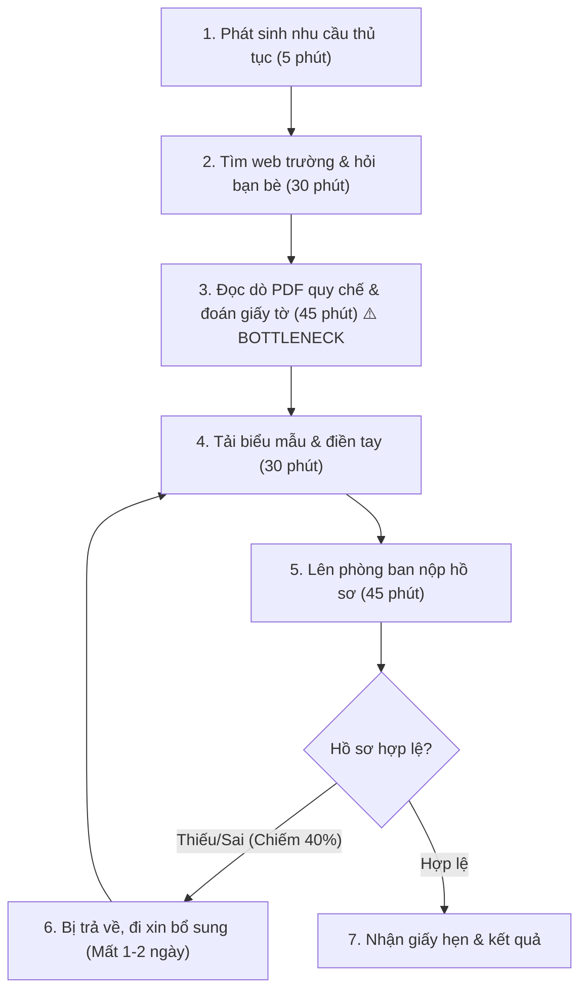
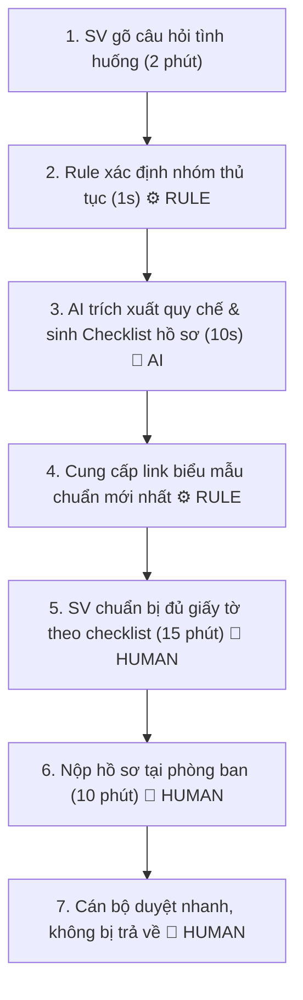

# Báo cáo nhóm — Day 02 Discovery & Problem Framing

> Bản chung của nhóm, viết trên repo do nhóm trưởng fork. Không copy file này sang repo cá nhân.
> Template chi tiết và prompt mẫu: [docs/01-worksheet.md](../../docs/01-worksheet.md). Bài mẫu: [docs/02-deliverable-example.md](../../docs/02-deliverable-example.md).

## 1. Thông tin nhóm

- Tên nhóm: **E305t108**
- Thành viên:
  1. **Đàm Hồng Thái** — MSSV: `2A202603927` (Trưởng nhóm)
  2. **Lê Quý Toàn** — MSSV: `2A202603941` (Thành viên)
- Candidate problem được chọn (1 câu): **Khi cần thực hiện thủ tục hành chính hoặc giải quyết vướng mắc học vụ tại trường, sinh viên gặp khó khăn khi tra cứu quy định rải rác và biểu mẫu phức tạp, dẫn đến tốn thời gian đi lại nhiều lần và làm quá tải cán bộ phòng ban.**
- Quyết định cuối: **Go, phạm vi nhỏ** (Thực hiện pilot trên 5 thủ tục hành chính có tần suất phát sinh cao nhất).

---

## 2. Hội tụ nhóm (CP3)

### 2.1. Pitch

Nhóm gồm 2 thành viên tiến hành pitch **12 candidate** tiêu biểu được tổng hợp từ ngân hàng Job Stories ban đầu của cả 2 thành viên (6 của Đàm Hồng Thái và 6 của Lê Quý Toàn):

| # | Người đưa ra | Candidate (Job Story ngắn) | Actor | Bottleneck | Câu hỏi phản biện nhận được (ai hỏi) |
|---:|---|---|---|---|---|
| 1 | Đàm Hồng Thái | Khi cần xem lịch học/lịch thi/phòng học, tôi muốn tra cứu tại một nơi để không phải tìm nhiều kênh | SV, lớp trưởng | Mở portal, group lớp, email tìm phòng học (5–10'/lần) | *"Portal trường đã có sẵn lịch học và lịch thi, nếu làm thêm giải pháp AI thì có bị trùng lặp tính năng và lãng phí không?"* (Lê Quý Toàn hỏi) |
| 2 | Đàm Hồng Thái | Khi tìm hiểu học bổng hoặc điều kiện tốt nghiệp, tôi muốn tổng hợp điều kiện/hồ sơ từ nhiều nguồn | SV, phòng CTSV, phòng đào tạo | Đọc và đối chiếu văn bản rải rác (40–60'/lần) | *"Tần suất làm học bổng chỉ 2–3 lần/năm, liệu có đo lường được hiệu quả trong một buổi lab không?"* (Lê Quý Toàn hỏi) |
| 3 | Đàm Hồng Thái | Khi các bạn trong lớp liên tục hỏi lịch thi/hạn nộp, tôi muốn có nguồn chung để chia sẻ giảm trả lời lặp lại | Lớp trưởng, cán bộ lớp | Tìm lại thông báo cũ trên Zalo (15–25'/tuần) | *"Đây là pain của người trả lời hay người hỏi? Lớp trưởng ghim thông báo Zalo là xong, cần gì giải pháp phức tạp?"* (Lê Quý Toàn hỏi) |
| 4 | Đàm Hồng Thái | Khi cần làm thủ tục hành chính trường, tôi muốn có hướng dẫn đủ và chuẩn để không phải đi lại nhiều lần | SV, cán bộ một cửa | Đọc dò văn bản quy chế dài 20–30 trang (45–60'/lần) | *"Sinh viên có thật sự chịu đọc hết văn bản quy chế không hay chỉ cần biết chính xác giấy tờ cần nộp?"* (Lê Quý Toàn hỏi) |
| 5 | Lê Quý Toàn | Khi nhận đánh giá sao thấp đa kênh, CSKH muốn phân loại lỗi tự động để xử lý nhanh trong 30' | CSKH, Quản lý chuỗi F&B | Đọc và gắn tag thủ công (45–60'/sáng) | *"Đề tài F&B này lấy đâu ra dữ liệu review thật để test trong lab 3 tiếng, và liệu có phỏng vấn được quản lý nhà hàng ngay bây giờ không?"* (Đàm Hồng Thái hỏi) |
| 6 | Lê Quý Toàn | Khi đến giờ giao ca trực, tôi muốn có danh sách sự cố vận hành phát sinh để bàn giao ca sau liền mạch | Trưởng ca (Shift Leader) | Gõ biên bản bàn giao và nhắc việc (20–30'/lần) | *"Trưởng ca có chịu ghi chép đầy đủ vào phần mềm không hay chỉ trao đổi miệng là xong?"* (Đàm Hồng Thái hỏi) |
| 7 | Lê Quý Toàn | Khi khách khiếu nại đơn hàng giao lỗi/thiếu món, CSKH muốn đối chiếu ảnh đóng gói để ra quyết định hoàn tiền trong 10' | CSKH, Thủ kho/Bếp | Tìm ảnh camera đóng gói và đối chiếu (25'/ticket) | *"Quy trình này phụ thuộc camera kho và shipper ngoài đường, liệu có vượt quá phạm vi buổi lab không?"* (Đàm Hồng Thái hỏi) |
| 8 | Lê Quý Toàn | Khi cần xin giấy xác nhận sinh viên / hoãn thi, tôi muốn biết chính xác hồ sơ cần gì để không bị cán bộ trả về | SV, Cán bộ đào tạo/CTSV | Đi lại 2–3 lần vì thiếu chứng từ hợp lệ (mất 2–3 ngày) | *"Lần gần nhất bạn làm thủ tục ở trường mất bao lâu? Sinh viên hay bị mắc kẹt nhất ở khâu nào?"* (Đàm Hồng Thái hỏi) |
| 9 | Đàm Hồng Thái | Khi gặp khó khăn học tập/cá nhân, tôi muốn biết nên liên hệ ai để được hỗ trợ kịp thời | SV gặp khó khăn, Cố vấn | Tìm đầu mối phụ trách rải rác (20–40') | *"Vấn đề này có cần AI xử lý không hay chỉ cần một trang danh bạ điện tử rõ ràng?"* (Lê Quý Toàn hỏi) |
| 10 | Lê Quý Toàn | Khi nhân viên mới vào ca trực, họ muốn biết chính sách đền bù chuẩn để phản hồi khách ngay | Nhân viên CSKH thử việc | Nhắn tin hỏi lặp lại trên Zalo (40'/ngày) | *"Đã có sẵn cẩm nang SOP nội bộ rồi, tại sao không cải thiện tài liệu đào tạo thay vì dùng AI?"* (Đàm Hồng Thái hỏi) |
| 11 | Đàm Hồng Thái | Khi gặp khó khăn làm bài tập/đồ án, tôi muốn tìm hướng giải quyết và tài liệu phù hợp để hoàn thành đúng hạn | SV, GV hướng dẫn | Tìm kiếm tài liệu tin cậy (20–60'/lần) | *"Tài liệu chuyên ngành rất phân tán và mang tính bảo mật, AI có giải quyết được không?"* (Lê Quý Toàn hỏi) |
| 12 | Lê Quý Toàn | Khi đối soát voucher đền bù cuối tháng, tôi muốn khớp số tiền với lý do khiếu nại để giám đốc phê duyệt | Trưởng CSKH, Kế toán | Đối chiếu thủ công giữa Excel và Fanpage (6–7 tiếng) | *"Có cần AI hay chỉ cần chuẩn hóa quy tắc nghiệp vụ trên phần mềm POS?"* (Đàm Hồng Thái hỏi) |

---

### 2.2. Cluster

Nhóm phân loại 12 candidate thành 3 cụm vấn đề (Cluster) dựa trên bản chất nghiệp vụ:

| Cluster | Các candidate thuộc nhóm | Pattern chung |
|---|---|---|
| **Cluster A: Tra cứu & Tổng hợp Lịch học, Thông báo** | Candidate #1, #2, #3, #9 | Dữ liệu mang tính thời điểm, thay đổi theo tuần/kỳ, phần lớn portal trường hoặc kênh chat lớp đã có sẵn nhưng bị phân mảnh; tần suất một số bài thấp (học bổng 2 lần/năm). |
| **Cluster B: Hướng dẫn Quy định & Thủ tục Hành chính** | Candidate #4, #8 | Văn bản quy chế dài (20–50 trang), biểu mẫu phân tán nhiều phòng ban, ngôn ngữ pháp lý khó hiểu; sinh viên rất sợ làm sai; cán bộ hành chính bị hỏi lặp lại gây quá tải nghiêm trọng. |
| **Cluster C: Nghiệp vụ Vận hành Doanh nghiệp & Học tập P2P** | Candidate #5, #6, #7, #10, #11, #12 | Phụ thuộc vào dữ liệu vận hành bên thứ ba (POS/camera đơn hàng F&B) hoặc rào cản kiểm chứng thực địa không thể làm xong trong buổi lab 3 tiếng. |

---

### 2.3. Opportunity Solution Tree rút gọn

Nhóm xác định **1 Outcome trọng tâm đo lường được**: Giảm thời gian sinh viên tra cứu và hoàn tất thủ tục hành chính, đồng thời giảm số lượt hỏi lặp lại tại văn phòng khoa/phòng đào tạo.

```text
OUTCOME: Giảm 60% thời gian sinh viên tra cứu & hoàn thiện hồ sơ thủ tục hành chính, 
         đồng thời giảm 50% số câu hỏi lặp lại cho cán bộ đào tạo/CTSV.
├── Opportunity 1: Sinh viên không biết thủ tục cần những giấy tờ gì và nộp ở phòng ban nào.
├── Opportunity 2: Sinh viên không hiểu các điều kiện ngoại lệ trong văn bản quy chế (hoãn thi, miễn giảm, bảo lưu).
└── Opportunity 3: Cán bộ phòng ban mất quá nhiều thời gian giải thích các câu hỏi lặp lại mỗi ngày.
     ✗ "Chatbot AI toàn năng giải đáp mọi thắc mắc"  ← SOLUTION, gạch bỏ khỏi tầng này
     ✗ "Xây dựng cổng portal một cửa mới"           ← SOLUTION, gạch bỏ khỏi tầng này
     ✗ "Sổ tay sinh viên điện tử"                   ← SOLUTION, gạch bỏ khỏi tầng này
     ✗ "Dùng ChatGPT giải đáp quy chế"              ← SOLUTION, gạch bỏ khỏi tầng này
```

*Những ý đã gạch bỏ vì là solution đội lốt opportunity:*
- "Chatbot AI trả lời tự động": Đây là giải pháp công nghệ, không phải nỗi đau của sinh viên.
- "Cổng portal tích hợp": Đây là tính năng phần mềm lớn vượt ngoài phạm vi giải quyết vấn đề.
- "Dùng ChatGPT": Công cụ cụ thể có nguy cơ hallucination cao, không phải nhu cầu người dùng.

---

### 2.4. Chấm điểm shortlist (Thang điểm 1–5)

Nhóm rút gọn 3 candidate đại diện cho 3 cluster để chấm điểm theo 7 tiêu chí:

| Candidate | Actor rõ | Quy trình rõ | Pain có bằng chứng | Impact đo được | Vừa sức lab | So sánh được No AI/Rule/Workflow/Agent | Nhóm hiểu domain | Tổng |
|---|---:|---:|---:|---:|---:|---:|---:|---:|
| **Candidate 1: Hướng dẫn thủ tục hành chính sinh viên (#4, #8)** | 5 | 5 | 5 | 5 | 5 | 5 | 5 | **35** |
| Candidate 2: Tra cứu lịch học, phòng học & lịch thi (#1) | 5 | 5 | 4 | 4 | 4 | 5 | 4 | 31 |
| Candidate 3: Gom & phân loại review F&B đa kênh (#5) | 5 | 5 | 4 | 5 | 2 | 5 | 3 | 29 |

**Candidate được chọn:** **Candidate 1 — Hướng dẫn & Tra cứu Thủ tục Hành chính, Quy chế Sinh viên tại Trường Đại học.**

**Vì sao chọn:**
1. *Actor và Quy trình cực kỳ rõ ràng:* Sinh viên cần làm giấy tờ $\rightarrow$ Tra cứu quy chế $\rightarrow$ Chuẩn bị hồ sơ $\rightarrow$ Nộp và chờ ký duyệt $\rightarrow$ Nhận kết quả.
2. *Pain thật, bằng chứng rõ ràng:* Cả 2 thành viên đều từng đi lại 2–3 lần vì thiếu giấy tờ xác nhận; cán bộ một cửa luôn trong tình trạng quá tải vào các đợt cao điểm đầu kỳ và trước kỳ thi.
3. *Đầu vào dữ liệu có sẵn và chuẩn xác:* Toàn bộ quy chế, biểu mẫu, quy trình một cửa của trường đã có sẵn trên văn bản PDF chính thức (Sổ tay sinh viên, Quyết định quy chế đào tạo).
4. *So sánh rõ ràng 4 mức giải pháp:* Có đất để phân định rạch ròi giữa việc dùng bảng FAQ tĩnh (No AI), chatbot cây quyết định (Rule), Workflow RAG trích xuất thông tin có trích dẫn, và chứng minh vì sao không được dùng Autonomous Agent.
5. *Vừa sức buổi lab:* 100% thành viên đều hiểu domain, dễ dàng phỏng vấn người thật ngay tại chỗ.

**Vì sao loại các candidate còn lại:**
- *Loại Candidate 2 (Lịch học/phòng học):* Hầu hết các trường đại học đã có app hoặc portal sinh viên hiển thị lịch tự động. Vấn đề chỉ là giao diện chưa đẹp; việc dùng AI vào đây là lãng phí tài nguyên và không có bài toán ngôn ngữ tự nhiên. Phụ thuộc API Zalo/Teams khó kiểm soát trong lab.
- *Loại Candidate 3 (Gom review F&B):* Mặc dù impact thương mại lớn nhưng gặp rào cản nghiêm trọng về kiểm chứng thực địa trong một buổi lab 3 tiếng (không có sẵn dữ liệu review thực tế và không thể phỏng vấn ngay 20 quản lý nhà hàng F&B tại lớp).

**Xử lý bất đồng:** Ban đầu Lê Quý Toàn muốn bảo vệ đề tài F&B (phân loại review), còn Đàm Hồng Thái muốn tập trung vào bài toán thông tin học vụ. Sau khi Thái phản biện về rào cản kiểm chứng người thật của đề tài F&B trong buổi lab 3 tiếng, và Toàn phản biện về rào cản phân quyền API của các kênh Zalo/Teams, cả hai bạn đã cùng thống nhất chuyển sang **Candidate 1 (Thủ tục hành chính sinh viên)** vì cả hai đều là sinh viên, hiểu sâu domain, có sẵn văn bản quy chế trường và có thể phỏng vấn người thật ngay tại lớp. Đồng thuận 100%, không có bất đồng kéo dài.

---

## 3. Kiểm chứng + research giải pháp đã có (CP4)

### 3.1. Assumption Map

Nhóm lập danh sách 5 giả định rủi ro then chốt:

| # | Giả định | Loại rủi ro | Quan trọng (1–5) | Đã có bằng chứng (1–5) | Kiểm chứng trước? |
|---:|---|---|---:|---:|:---:|
| 1 | Sinh viên mất nhiều thời gian đọc quy chế và hay bị nộp thiếu giấy tờ | Value | 5 | 3 | ✅ (Kiểm chứng ngay) |
| 2 | Cán bộ văn phòng khoa/CTSV bị quá tải bởi các câu hỏi thủ tục lặp lại | Value | 4 | 2 | ✅ (Kiểm chứng ngay) |
| 3 | Sinh viên sẵn sàng tra cứu qua công cụ tự động thay vì nhắn tin hỏi bạn bè | Usability | 4 | 2 | ✅ (Kiểm chứng ngay) |
| 4 | Văn bản quy chế của trường đủ rõ ràng để trích xuất điều kiện logic | Feasibility | 5 | 4 | — (Đã có file PDF) |
| 5 | Nhà trường cho phép sinh viên nộp trước bản mềm hồ sơ qua mạng | Viability | 4 | 2 | Hỏi cán bộ sau |

**Giả định nhóm tập trung kiểm chứng trong buổi lab:** Giả định #1, #2 và #3 thông qua phỏng vấn người thật theo phương pháp **The Mom Test**.

---

### 3.2. Kiểm chứng thực tế

Nhóm thực hiện phỏng vấn nhanh **3 người thật** tại khuôn viên trường theo 3 luật của The Mom Test (hỏi về trải nghiệm quá khứ, không hỏi giả định tương lai, không khen ngợi ý tưởng):

#### Interview Snapshot 1 — Sinh viên năm 2 xin hoãn thi vì lý do sức khỏe
* **Người được hỏi:** Sinh viên năm 2, Khoa Công nghệ Thông tin.
* **Câu nói đáng nhớ nhất (nguyên văn):** *"Lúc em bị sốt xuất huyết nằm viện, mẹ em lên trường nộp đơn hoãn thi thì bị bảo thiếu giấy xác nhận của bệnh viện tuyến quận trở lên. Quy chế ghi chung chung là 'cơ sở y tế có thẩm quyền', ai biết thẩm quyền là cấp nào đâu!"*
* **Lần gần nhất gặp vấn đề này:** Kỳ thi cuối kỳ II năm ngoái (tháng 6).
* **Workaround hiện tại:** Phải nhờ người nhà chạy về bệnh viện xin lại giấy xác nhận đúng tuyến, nộp lại lần 2 mất trọn 2 ngày.
* **Mất bao lâu:** Mất 2 ngày đi lại, suýt bị tính điểm 0 vì quá hạn nộp đơn 48 giờ sau khi thi.
* **Insight rút ra:** Nỗi đau không phải là không có đơn, mà là **không hiểu rõ tiêu chuẩn hợp lệ của các giấy tờ đính kèm** trong văn bản quy chế.

#### Interview Snapshot 2 — Sinh viên năm 3 xin giấy xác nhận vay vốn ngân hàng chính sách
* **Người được hỏi:** Sinh viên năm 3, Khoa Quản trị Kinh doanh.
* **Câu nói đáng nhớ nhất (nguyên văn):** *"Tải mẫu đơn trên web trường về in ra, điền xong đem lên nộp thì thầy bảo mẫu này cũ từ năm 2022 rồi, mẫu mới phải có mã định danh VNeID. Web trường có tới 3 chỗ để file tải về, không biết cái nào là bản cập nhật."*
* **Lần gần nhất gặp vấn đề này:** Đầu tháng 10/2026 khi làm hồ sơ gia hạn vay vốn sinh viên.
* **Workaround hiện tại:** Phải chạy ra quán photo cổng trường hỏi xin mẫu chuẩn mà các bạn khác hay in.
* **Mất bao lâu:** Đi lại 3 lần giữa phòng Đào tạo và phòng CTSV, mất 4 tiếng.
* **Insight rút ra:** Biểu mẫu bị phân mảnh, có tình trạng tồn tại song song biểu mẫu cũ và mới khiến sinh viên bị làm sai.

#### Interview Snapshot 3 — Lớp trưởng kiêm cán bộ hỗ trợ văn phòng khoa
* **Người được hỏi:** Lớp trưởng lớp K67, trực hỗ trợ bàn một cửa văn phòng khoa.
* **Câu nói đáng nhớ nhất (nguyên văn):** *"Mỗi đợt đầu kỳ, một ngày em nhận không dưới 30 tin nhắn hỏi cùng một câu: 'Xin giấy xác nhận sinh viên nộp ở đâu', 'Bị trùng lịch học thì làm đơn gì'. Em ghim bài trên Zalo rồi mà các bạn lười đọc, cứ inbox hỏi trực tiếp."*
* **Lần gần nhất gặp vấn đề này:** Tuần sinh hoạt công dân đầu năm học (tháng 9).
* **Workaround hiện tại:** Lưu sẵn 1 file Word chứa các link và tin nhắn mẫu, ai hỏi thì copy-paste gửi lại.
* **Mất bao lâu:** Khoảng 45–60 phút mỗi ngày trong 2 tuần cao điểm đầu kỳ.
* **Insight rút ra:** Cán bộ và lớp trưởng rất cần một hệ thống chuẩn để sinh viên tự tra cứu đúng biểu mẫu, tránh việc trả lời lặp đi lặp lại.

#### Bảng tổng hợp kiểm chứng:

| Nguồn | Số mẫu | Tín hiệu xác nhận | Tín hiệu phản bác |
|---|---:|---|---|
| **Phỏng vấn trực tiếp** | 3 người (2 SV, 1 Lớp trưởng) | 3/3 đều xác nhận quy chế khó hiểu, biểu mẫu tải sai phiên bản, tốn ít nhất 2–3 lượt đi lại | 1 sinh viên cho biết các thủ tục đơn giản (như cấp bảng điểm) làm qua cổng portal trường đã tương đối ổn, chỉ có các thủ tục giải quyết việc cá biệt (hoãn thi, bảo lưu, học bổng xã hội) mới rối rắm |
| **Micro Survey nhanh trong lớp** | 12 sinh viên | 10/12 (83%) từng phải hỏi người khác về thủ tục hành chính; 8/12 từng nộp thiếu/sai giấy tờ | 2 bạn cho biết thường nhờ bạn bè làm hộ hoặc hỏi thẳng cố vấn học tập nên không tự tra cứu |

**Nhóm đã sửa problem thế nào sau kiểm chứng:**
1. **Thu hẹp phạm vi:** Không làm cho toàn bộ 50+ thủ tục của trường. Tập trung giải quyết **5 thủ tục phức tạp và hay sai sót nhất**: (1) Hoãn thi/thi bù vì lý do bất khả kháng, (2) Đơn xin nghỉ học tạm thời (bảo lưu), (3) Xác nhận sinh viên để vay vốn/hoãn nghĩa vụ quân sự, (4) Miễn giảm học phí đối tượng chính sách, (5) Quy đổi chứng chỉ tiếng Anh chuẩn đầu ra.
2. **Bổ sung yêu cầu biểu mẫu chuẩn:** Hệ thống không chỉ giải thích quy định mà phải **cung cấp đúng đường link tải biểu mẫu phiên bản mới nhất** có đóng dấu hiệu lực.

---

### 3.3. Research giải pháp đã có

| Công cụ / Case study | Link chính thức | Giải bước nào trong quy trình? | Điểm mạnh | Khoảng trống / Rủi ro | Bài học cho nhóm |
|---|---|---|---|---|---|
| **Chatbot Hỏi đáp Tuyển sinh & Đào tạo (HUST Bot / VNU Portal Bot)** | https://ts.hust.edu.vn/ | Giải bước 1 & 2: Giải đáp câu hỏi cơ bản về học phí, chỉ tiêu tuyển sinh | Tự động trả lời tức thì 24/7 | Sử dụng cây kịch bản (Rule-based) cứng nhắc; khi sinh viên hỏi tình huống phức tạp có điều kiện kết hợp thì trả lời vòng vo hoặc báo "không hiểu" | Không dùng Chatbot kịch bản cứng; cần dùng công nghệ trích xuất ngữ nghĩa (RAG) trên kho tài liệu quy chế |
| **Cổng Dịch vụ một cửa điện tử (Trường ĐH Bách Khoa TP.HCM)** | https://mybk.hku.edu.vn/ | Giải bước 3 & 4: Cho phép nộp đơn online và theo dõi trạng thái hồ sơ | Chuẩn hóa quy trình thành form trực tuyến, giảm việc nộp giấy | Chỉ tiếp nhận form đã điền; không có bước tư vấn hướng dẫn trước khi nộp khiến sinh viên đính kèm file sai quy cách liên tục | Bài toán nằm ở **khâu chuẩn bị hồ sơ trước khi nộp**, chứ không phải khâu truyền nhận file |
| **Sổ tay Sinh viên điện tử dạng PDF tìm kiếm (VinUni / NEU Student Handbook)** | https://vinuni.edu.vn/current-students/ | Giải bước 1: Cung cấp đầy đủ toàn bộ văn bản quy chế | Thông tin chính thống 100%, có giá trị pháp lý | File PDF dài 180 trang; sinh viên dùng Ctrl+F rất khó tra vì ngôn ngữ hành chính khác với ngôn ngữ sinh viên hay dùng | Cần công cụ chuyển đổi ngôn ngữ đời thường của sinh viên sang đúng thuật ngữ hành chính trong quy chế |

**Kết luận Research:**
Thị trường đã có cổng tiếp nhận hồ sơ và có file PDF quy chế, nhưng **hoàn toàn bỏ trống khâu hướng dẫn chuẩn bị hồ sơ thông minh**. Khoảng trống giá trị lớn nhất là: **Chuyển hóa câu hỏi tình huống của sinh viên $\rightarrow$ Đối chiếu quy chế chính thống $\rightarrow$ Đưa ra Checklist hồ sơ cần chuẩn bị kèm link biểu mẫu chuẩn.**

---

## 4. Quy trình trước/sau (CP5)

### 4.1. Quy trình hiện tại

```text
HIỆN TẠI — Tổng thời gian: 4–6 tiếng (kéo dài qua 2–3 ngày làm việc)

[1. Phát sinh nhu cầu làm thủ tục] (5')
→ [2. Tìm quy chế trên web trường & hỏi bạn bè/Zalo] (30')
→ [3. Đọc dò văn bản PDF 20–30 trang & tự đoán giấy tờ cần nộp] (45') ← BOTTLENECK
→ [4. Tải biểu mẫu (dễ tải nhầm mẫu cũ) & tự điền đơn] (30')
→ [5. Lên văn phòng khoa/trường xếp hàng nộp hồ sơ] (45')
→ [6. Bị cán bộ trả về vì thiếu giấy tờ xác nhận / sai mẫu] (15') ← RỦI RO LẶP LẠI BƯỚC 3 & 4
→ [7. Bổ sung giấy tờ & nộp lại lần 2] (60')
```



| Bước | Actor | Input | Output | Thời gian / Tần suất | Ghi chú |
|---:|---|---|---|---|---|
| 1 | Sinh viên | Sự cố phát sinh (ốm, xin nghỉ, xin giấy) | Nhu cầu làm thủ tục | 5 phút | Đột xuất hoặc theo đợt |
| 2 | Sinh viên | Web trường, group Zalo lớp | Thông tin truyền miệng rời rạc | 30 phút | Dễ nhận thông tin sai lệch |
| 3 | Sinh viên | File PDF quy chế 20–30 trang | Dự đoán danh mục giấy tờ cần nộp | **45 phút (BOTTLENECK)** | Ngôn ngữ quy chế khó hiểu, dễ đoán sai |
| 4 | Sinh viên | Link tải trên mạng | Đơn đã in và điền tay | 30 phút | Dễ tải nhầm biểu mẫu cũ |
| 5 | Sinh viên, Cán bộ | Hồ sơ giấy | Tiếp nhận hoặc từ chối | 45 phút (cả xếp hàng) | Cán bộ mất thời gian giải thích lại |
| 6 | Cán bộ, Sinh viên | Hồ sơ bị lỗi | Yêu cầu làm lại | Mất thêm 1–2 ngày | Tốn công sức đi lại của sinh viên |

**Bottleneck chính:** **Bước 3 (Đọc dò văn bản PDF quy chế để bóc tách giấy tờ cần nộp)**. Sinh viên không thể tự tin mình đã chuẩn bị đúng và đủ giấy tờ hợp lệ theo quy chế.

---

### 4.2. Quy trình tương lai (Ứng dụng Workflow AI + Rule)

```text
TƯƠNG LAI — Tổng thời gian: Dưới 30 phút (Không tính thời gian chờ phê duyệt)

[1. Sinh viên nhập câu hỏi tình huống bằng ngôn ngữ tự nhiên] (2')
→ [2. Rule lọc: Xác định thuộc 1 trong 5 nhóm thủ tục chuẩn] (1 giây) ← RULE
→ [3. AI Engine: Trích xuất điều khoản quy chế, tạo Checklist giấy tờ chuẩn xác 100%] (10 giây) ← AI (RAG)
→ [4. Hệ thống xuất link tải biểu mẫu phiên bản mới nhất + Hướng dẫn nộp] (1 giây) ← RULE
→ [5. Sinh viên kiểm tra checklist & chuẩn bị đúng ngay lần đầu] (15') ← CON NGƯỜI
→ [6. Nộp trực tiếp tại bàn một cửa hoặc tải lên cổng portal] (10') ← CON NGƯỜI
→ [7. Cán bộ tiếp nhận phê duyệt ngay, tỷ lệ trả về < 5%] ← CON NGƯỜI
```



**Phân định ranh giới & Kiểm soát:**
- **RULE xử lý:** Định tuyến nhóm thủ tục; cung cấp URL tải file `.docx` biểu mẫu chuẩn có chữ ký số của nhà trường; kiểm tra thời hạn hiệu lực của văn bản.
- **AI xử lý:** Đọc hiểu câu hỏi tự nhiên của sinh viên, tìm kiếm ngữ nghĩa (Semantic search) trong kho quy chế PDF, trích xuất điều kiện cụ thể (ví dụ: *"phải có xác nhận của bệnh viện cấp quận/huyện trở lên"*), sinh ra bảng Checklist giấy tờ cần chuẩn bị.
- **CON NGƯỜI (Human-in-the-loop):** Sinh viên tự chuẩn bị giấy tờ thật; Cán bộ hành chính là người **duyệt cuối cùng và ký xác nhận**.
- **BOUNDARY (Ranh giới an toàn):** AI **tuyệt đối KHÔNG có quyền tự động duyệt đơn, không tự cấp con dấu hoặc giấy xác nhận**.
- **PHƯƠNG ÁN QUAY VỀ (Fallback):** Nếu AI không tìm thấy quy chế tương ứng (Confidence thấp), hệ thống hiển thị thông tin liên hệ trực tiếp của Thầy/Cô phụ trách tại Văn phòng Khoa để sinh viên đến hỏi trực tiếp.

---

### 4.3. Bảng so sánh Before / After

| Chỉ số | Trước (Hiện tại) | Sau (Kỳ vọng) | Ghi chú |
|---|---:|---:|---|
| **Tổng thời gian chuẩn bị hồ sơ** | 120–180 phút (kéo dài 2–3 ngày) | **Dưới 30 phút** | Giảm hơn 75% thời gian tra cứu và chuẩn bị |
| **Số lần sinh viên phải đi lại** | 2–3 lần | **1 lần duy nhất** | Chuẩn bị đúng đủ hồ sơ ngay từ đầu |
| **Tỷ lệ hồ sơ bị trả về do sai/thiếu** | ~40% (theo khảo sát) | **Dưới 5%** | Hạn chế tối đa việc tải nhầm biểu mẫu cũ |
| **Thời gian cán bộ giải thích thủ tục** | 45–60 phút/ngày | **Dưới 15 phút/ngày** | Giảm tải rõ rệt cho bàn một cửa |
| **Rủi ro mới phát sinh** | Không có (chỉ tốn công) | AI hiểu nhầm quy chế mới cập nhật | Xử lý bằng việc: AI bắt buộc phải trích dẫn số hiệu điều khoản và có cơ chế kiểm duyệt nội dung khi trường đổi văn bản |

---

## 5. Problem Statement v0 (CP5)

| Trường | Nội dung |
|---|---|
| **Actor** | Sinh viên đại học (đặc biệt sinh viên năm 1, năm 2) cần thực hiện các thủ tục hành chính, và Cán bộ phụ trách bàn một cửa tại các trường đại học. |
| **Quy trình** | Khi phát sinh nhu cầu thủ tục $\rightarrow$ Tìm kiếm quy chế trên web trường/hỏi bạn bè $\rightarrow$ Đọc dò văn bản PDF 20–30 trang $\rightarrow$ Tự tìm biểu mẫu và điền tay $\rightarrow$ Nộp tại văn phòng và chờ xử lý. |
| **Bottleneck** | Bước đọc dò văn bản PDF quy chế để xác định điều kiện và bóc tách giấy tờ cần nộp mất 45 phút, dễ hiểu sai từ ngữ hành chính dẫn đến chuẩn bị thiếu hồ sơ. |
| **Impact** | 40% sinh viên bị trả về làm lại hồ sơ, mất 2–3 ngày đi lại; cán bộ văn phòng một cửa mất 1–2 tiếng mỗi ngày chỉ để giải thích lặp đi lặp lại cùng một quy trình. |
| **Success Metric** | (1) Giảm thời gian chuẩn bị hồ sơ từ 120 phút xuống dưới 30 phút; (2) Tỷ lệ hồ sơ bị trả về do sai/thiếu giảm từ 40% xuống dưới 10%; (3) Số câu hỏi thủ tục lặp lại gửi cán bộ giảm 50% trong đợt cao điểm đầu kỳ. |
| **Boundary** | AI chỉ có nhiệm vụ trích xuất quy định và sinh checklist hướng dẫn; AI **không được tự động duyệt đơn, không can thiệp vào quyết định cấp phép của nhà trường**. Mọi hồ sơ phải có chữ ký và phê duyệt của cán bộ có thẩm quyền. |

**Phản biện nhận được (từ AI & nhóm bạn):**
- *Phản biện 1:* Metric giảm tỷ lệ trả về từ 40% xuống 10% đo bằng cách nào? $\rightarrow$ Nhóm ghi nhận: Sẽ đối chiếu sổ theo dõi tiếp nhận hồ sơ tại Văn phòng Khoa trong 2 tuần cao điểm.
- *Phản biện 2:* Nếu quy chế trường vừa đổi ngày hôm qua mà AI chưa cập nhật thì sao? $\rightarrow$ Nhóm đồng ý: Cần thêm trường ngày cập nhật văn bản và cảnh báo sinh viên đối chiếu số hiệu quyết định ở v1.

---

## 6. Mức can thiệp AI (CP6)

### 6.1. Ma trận độ mơ hồ × độ phức tạp

- **Độ mơ hồ (Ambiguity):** **Trung bình**. Câu hỏi của sinh viên viết bằng ngôn ngữ tự nhiên, tiếng lóng, ngữ cảnh cá nhân rất đa dạng ("em bị té xe gãy tay lỡ thi môn Toán thì làm sao"). Tuy nhiên, đầu ra mong đợi là xác định (đúng quy chế, đúng biểu mẫu).
- **Độ phức tạp (Complexity):** **Thấp – Trung bình**. Quy trình gồm 4–5 bước cố định, kho tài liệu là tập hợp các file PDF quy chế chính thức của trường (không rẽ nhánh động, không cần tương tác nhiều hệ thống ngoài).
- **Vị trí trên ma trận:** Nằm ở ô **Workflow tích hợp AI (RAG Workflow)**. Không cần thiết và không được phép dùng Autonomous Agent.

---

### 6.2. So sánh 4 mức

| Mức | Phương án cho bài của nhóm | Đủ khi nào | Rủi ro | Chọn? |
|---|---|---|---|---|
| **No AI** | Sổ tay sinh viên in giấy + file FAQ tổng hợp tải về | Khi sinh viên chịu khó đọc và câu hỏi chỉ xoay quanh quy định cơ bản | Sinh viên lười đọc PDF dài, không tìm được từ khóa tương ứng với hoàn cảnh thực tế | Không chọn |
| **Rule** | Chatbot bấm nút theo kịch bản có sẵn (Menu-driven / Decision tree) | Khi sinh viên biết chính xác mình cần tìm thủ tục tên là gì | Rất dễ bế tắc khi sinh viên mô tả hoàn cảnh bằng ngôn ngữ đời thường; tạo kịch bản quá tốn công | Không chọn |
| **Workflow** | Rule lọc nhóm thủ tục $\rightarrow$ AI đọc hiểu ngữ cảnh & trích xuất điều khoản $\rightarrow$ Xuất checklist + link mẫu đơn $\rightarrow$ Người duyệt | Đủ cho 95% trường hợp câu hỏi thủ tục học vụ và hành chính sinh viên | AI có thể ảo giác nếu câu hỏi nằm ngoài tài liệu quy chế (xử lý bằng threshold tự tin) | **CHỌN** |
| **Agent** | AI tự động thay mặt sinh viên nộp hồ sơ, tự gửi email cho giảng viên, tự động duyệt đơn | Khi hệ thống hành chính của trường cho phép AI can thiệp sâu vào cơ sở dữ liệu | Cực kỳ nguy hiểm: rủi ro vi phạm quy chế đào tạo, giả mạo thông tin, chi phí xây dựng khổng lồ | Loại bỏ |

**Vì sao không chọn mức đơn giản hơn (Rule/No AI):** Khảo sát thực tế cho thấy sinh viên không dùng FAQ/sổ tay vì không biết từ khóa hành chính chuẩn (ví dụ: sinh viên tìm "nghỉ học 1 kỳ" trong khi quy chế dùng từ "nghỉ học tạm thời/bảo lưu"). Rule-based dựa trên từ khóa sẽ trả về kết quả rỗng. Chỉ có AI mới có khả năng ánh xạ ngữ nghĩa giữa hoàn cảnh đời thường của sinh viên và ngôn ngữ hành chính học thuật.

**Vì sao không chọn mức phức tạp hơn (Agent):** Rủi ro pháp lý và quy chế học vụ không cho phép bất kỳ hệ thống tự động nào được quyền ký duyệt hồ sơ thay cho cán bộ đào tạo.

---

### 6.3. AI Canvas rút gọn

| Thành phần | Nội dung |
|---|---|
| **Prediction (AI dự đoán gì?)** | (1) Phân loại câu hỏi của sinh viên vào đúng thủ tục hành chính tương ứng; (2) Trích xuất các điều kiện tiên quyết và danh mục giấy tờ cần nộp từ văn bản quy chế. |
| **Judgment (Con người cân nhắc gì?)** | Cán bộ kiểm tra tính xác thực của các giấy tờ gốc (chữ ký bác sĩ, con dấu bệnh viện, chứng chỉ photo công chứng); Sinh viên tự đánh giá mình có đủ điều kiện theo checklist không. |
| **Action (Hành động là gì?)** | Hệ thống cung cấp bảng Checklist hướng dẫn + Link tải file mẫu `.docx`; Sinh viên chuẩn bị hồ sơ; Cán bộ ký duyệt. |
| **Outcome (Đo kết quả bằng gì?)** | Thời gian chuẩn bị hồ sơ của sinh viên; Tỷ lệ hồ sơ nộp đúng ngay lần đầu; Số lượt hỏi lặp lại tại văn phòng. |
| **Input (Dữ liệu đầu vào mỗi lần chạy)** | Câu hỏi mô tả tình huống của sinh viên (text) + Kho văn bản quy chế, quyết định và biểu mẫu chuẩn của trường (file PDF/Docx đã index). |
| **Feedback (Lấy phản hồi ở đâu để cải thiện?)** | Đánh giá của sinh viên (Hữu ích / Không hữu ích); Phản hồi của cán bộ tiếp nhận về các lỗi giấy tờ mới phát sinh để cập nhật prompt/quy chế. |

---

### 6.4. Hai câu hỏi của Google PAIR

1. **Người dùng muốn được hỗ trợ (Augment) hay giao hẳn việc (Automate)?**
   - **Trả lời: Được hỗ trợ (Augment).** 
   - *Bằng chứng:* Phỏng vấn sinh viên cho thấy họ muốn được chỉ dẫn rõ ràng cần chuẩn bị những gì để họ tự làm; không sinh viên nào muốn giao thông tin cá nhân cho bot tự nộp vì lo ngại lỗi hệ thống làm mất hồ sơ. Cán bộ hành chính cũng khẳng định chỉ chấp nhận chữ ký sống/chữ ký số của chính sinh viên.
2. **AI sai kiểu nào tệ hơn: Báo nhầm (False Positive) hay Bỏ sót (False Negative)?**
   - **Trả lời: Bỏ sót giấy tờ cần nộp (False Negative) tệ hơn rất nhiều so với báo thừa.**
   - *Lý do:* Nếu AI bỏ sót 1 loại giấy tờ bắt buộc (ví dụ quên nhắc giấy xác nhận của địa phương), sinh viên đem hồ sơ lên trường sẽ bị trả về ngay lập tức, làm hỏng toàn bộ mục tiêu của hệ thống. Nếu AI nhắc thừa một giấy tờ phụ, sinh viên chỉ mất thêm 2 phút chuẩn bị.
   - *Thiết kế xử lý:* Bộ tiêu chí đánh giá và prompt của AI được cấu hình để ưu tiên độ bao phủ (High Recall) đối với danh mục giấy tờ yêu cầu.

---

## 7. Problem Statement v1 + tiêu chí đánh giá (CP6)

| Trường | Nội dung |
|---|---|
| **Actor** | Sinh viên đại học (đặc biệt sinh viên năm 1–3) cần làm thủ tục học vụ, và Cán bộ văn phòng khoa/phòng Đào tạo trực tiếp tiếp nhận hồ sơ. |
| **Quy trình** | Nhập câu hỏi tình huống $\rightarrow$ AI trích xuất quy định và sinh checklist giấy tờ $\rightarrow$ Hệ thống cấp biểu mẫu chuẩn $\rightarrow$ Sinh viên chuẩn bị giấy tờ $\rightarrow$ Nộp cán bộ duyệt. |
| **Bottleneck** | Bước đọc dò văn bản PDF quy chế để bóc tách giấy tờ cần nộp mất 45 phút, dễ hiểu sai từ ngữ hành chính dẫn đến chuẩn bị thiếu hồ sơ. |
| **Impact** | 40% sinh viên bị trả về làm lại hồ sơ, mất 2–3 ngày đi lại; cán bộ văn phòng một cửa mất 1–2 tiếng mỗi ngày chỉ để giải thích lặp đi lặp lại cùng một quy trình. |
| **Success Metric** | (1) Thời gian sinh viên chuẩn bị hồ sơ giảm từ 120' xuống dưới 30'; (2) Tỷ lệ hồ sơ bị trả về giảm từ 40% xuống dưới 5%; (3) Tỷ lệ sinh viên tự chuẩn bị đúng hồ sơ đạt $\ge 90\%$; (4) **AI Macro-F1 $\ge 0.88$**, **Recall danh mục giấy tờ $\ge 0.95$**. |
| **Boundary** | AI chỉ tư vấn và sinh checklist; **tuyệt đối không tự động duyệt đơn, không tự cấp giấy tờ**. Bắt buộc phải dẫn nguồn số hiệu điều khoản quy chế tương ứng. |
| **AI intervention point** | Nằm ở khâu tư vấn ban đầu: Ngay sau khi sinh viên nêu hoàn cảnh và trước khi sinh viên tải biểu mẫu điền thông tin. |
| **Mức chọn** | **Workflow tích hợp AI (RAG Workflow)** |
| **Rủi ro & người kiểm tra** | Rủi ro AI trích dẫn quy chế cũ hoặc hiểu sai điều kiện ngoại lệ $\rightarrow$ **Cán bộ văn phòng khoa kiểm tra định kỳ kho dữ liệu văn bản; sinh viên đối chiếu số hiệu điều khoản được trích dẫn.** |

### Thay đổi so với v0 và lý do:

| Trường | v0 | v1 | Vì sao đổi |
|---|---|---|---|
| **Success Metric** | Chỉ đo thời gian và tỷ lệ trả về chung chung | Bổ sung chỉ số chất lượng AI: Macro-F1 $\ge 0.88$, **Recall danh mục giấy tờ $\ge 0.95$** | Phản biện: Nhanh hơn nhưng AI liệt kê thiếu giấy tờ thì sinh viên vẫn bị trả về |
| **AI intervention point** | Chưa xác định cụ thể | Nằm ở bước tư vấn trước khi tải form | Làm rõ chính xác AI chen vào bước nghẽn nào trong quy trình |
| **Rủi ro & Kiểm soát** | Chỉ nêu ranh giới cấm AI duyệt đơn | Bổ sung cơ chế bắt buộc trích dẫn số hiệu điều khoản và kiểm duyệt kho văn bản | Đảm bảo tính pháp lý và khả năng đối chiếu ngược của sinh viên |

### Tiêu chí đánh giá đầu ra của AI (5 tiêu chí):

| # | Tiêu chí | Đạt khi | Không đạt khi |
|---:|---|---|---|
| 1 | **Đúng quy chế & Có trích dẫn (Citation Accuracy $\ge 95\%$)** | Nêu chính xác tên thủ tục và trích dẫn đúng số hiệu điều khoản trong Quyết định quy chế đào tạo/CTSV hiện hành của trường | Trích dẫn sai điều khoản, lấy quy chế trường khác, hoặc không dẫn nguồn (Hallucination) |
| 2 | **Đầy đủ danh mục giấy tờ (High Recall $\ge 0.95$)** | Liệt kê đủ 100% các giấy tờ bắt buộc theo quy định cho trường hợp cụ thể của sinh viên (không được bỏ sót) | Bỏ sót dù chỉ 1 loại giấy tờ hoặc con dấu/chữ ký bắt buộc |
| 3 | **Đúng link biểu mẫu mới nhất (Form URL Accuracy = 100%)** | Cung cấp link tải trực tiếp biểu mẫu phiên bản mới nhất năm học hiện tại | Đưa link chết (404), link mẫu cũ chưa cập nhật, hoặc không có file đính kèm |
| 4 | **Cảnh báo điều kiện tiên quyết & Hạn chót** | Nêu rõ các mốc thời gian hạn chót (deadlines) và điều kiện loại trừ (ví dụ: đơn hoãn thi phải nộp trong 48h sau thi) | Không nhắc nhở về thời hạn nộp hoặc điều kiện tiên quyết |
| 5 | **Định tuyến Fallback chuẩn xác** | Nhận diện đúng các câu hỏi ngoài phạm vi hoặc trường hợp đặc biệt ngoài quy chế để chuyển tiếp hotline/bàn một cửa | Cố trả lời bịa đặt khi tài liệu không có thông tin hoặc tự tin thấp |

---

### 7.4. Bộ Eval mẫu 10 cặp Input / Output thử nghiệm (Đạt chuẩn Bonus B3)

Dưới đây là bộ 10 test case đa dạng thử nghiệm bước Workflow AI tương ứng với 5 thủ tục cốt lõi và các tình huống biên/ngoại lệ:

| # | Input của Sinh viên | Đầu ra mong đợi của AI (Checklist, Link mẫu & Cảnh báo) | Tiêu chí Eval đạt |
|---:|---|---|---|
| 1 | *"Em bị sốt xuất huyết phải nằm viện đúng hôm thi môn Giải tích 2, em cần làm gì để được thi bù ạ?"* | • Tên thủ tục: **Hoãn thi vì lý do bất khả kháng** (Điều 15 Quy chế Đào tạo).<br>• Checklist giấy tờ: (1) Đơn xin hoãn thi theo mẫu; (2) Giấy ra viện hoặc xác nhận điều trị nội trú có dấu tròn bệnh viện cấp quận/huyện trở lên.<br>• Link biểu mẫu: `https://dt.edu.vn/bieumau/BM-HT-2026.docx`<br>• Cảnh báo hạn chót: Phải nộp trong vòng **48 giờ** kể từ giờ thi. | Đạt Tiêu chí 1, 2, 3, 4 |
| 2 | *"Em muốn xin giấy xác nhận sinh viên để về quê làm hồ sơ vay vốn Ngân hàng Chính sách Xã hội kỳ này."* | • Tên thủ tục: **Cấp Giấy xác nhận sinh viên vay vốn tín dụng**.<br>• Checklist: (1) Đơn xin xác nhận theo mẫu Ngân hàng CSXH (Mẫu 01/TDSV); (2) Bản photo CCCD gắn chip.<br>• Link biểu mẫu: `https://ctsv.edu.vn/bieumau/BM-VayVon-2026.docx`<br>• Nơi nộp & thời gian: Bàn 2 Phòng CTSV; nhận kết quả sau 24h làm việc. | Đạt Tiêu chí 1, 2, 3 |
| 3 | *"Em muốn xin nghỉ học tạm thời 1 học kỳ vì việc gia đình thì cần làm những gì?"* | • Tên thủ tục: **Nghỉ học tạm thời (Bảo lưu kết quả học tập)** (Điều 18 Quy chế Đào tạo).<br>• Điều kiện: Đã học ít nhất 1 học kỳ tại trường và không thuộc diện bị buộc thôi học.<br>• Checklist: (1) Đơn xin nghỉ học tạm thời có ý kiến đồng ý của phụ huynh; (2) Bản xác nhận hoàn tất nghĩa vụ học phí và thư viện.<br>• Link biểu mẫu: `https://dt.edu.vn/bieumau/BM-BaoLuu-2026.docx` | Đạt Tiêu chí 1, 2, 3, 4 |
| 4 | *"Bố em là thương binh hạng 3/4, em muốn làm hồ sơ miễn giảm học phí thì cần giấy tờ gì nộp ở đâu?"* | • Tên thủ tục: **Miễn giảm học phí đối tượng chính sách** (Nghị định 81/CP).<br>• Checklist: (1) Đơn đề nghị miễn giảm học phí theo mẫu; (2) Bản sao công chứng Thẻ thương binh của bố; (3) Giấy khai sinh công chứng.<br>• Link biểu mẫu: `https://ctsv.edu.vn/bieumau/BM-MGHP-2026.docx`<br>• Hạn chót: Nộp trước ngày 15 của tháng đầu tiên trong học kỳ. | Đạt Tiêu chí 1, 2, 3, 4 |
| 5 | *"Em có bằng IELTS 6.5 thi tháng 8/2026, muốn nộp để miễn học và công nhận chuẩn đầu ra tiếng Anh."* | • Tên thủ tục: **Quy đổi điểm và miễn học phần Tiếng Anh chuẩn đầu ra**.<br>• Checklist: (1) Đơn đề nghị quy đổi điểm chứng chỉ quốc tế; (2) Bản gốc chứng chỉ IELTS để đối chiếu; (3) Bản photo chứng chỉ IELTS công chứng.<br>• Link biểu mẫu: `https://dt.edu.vn/bieumau/BM-QuyDoiTA-2026.docx`<br>• Cảnh báo: Chứng chỉ phải còn hạn 2 năm tính đến ngày nộp đơn. | Đạt Tiêu chí 1, 2, 3, 4 |
| 6 | *"Em bị ốm thi xong từ tuần trước rồi, nay mới đỡ thì có làm đơn xin hoãn thi môn đó được không?"* | • Phản hồi: **Từ chối theo quy định**.<br>• Trích dẫn: Căn cứ Khoản 3 Điều 15 Quy chế Đào tạo, đơn hoãn thi chỉ được giải quyết khi nộp trong vòng 48 giờ sau buổi thi.<br>• Hướng dẫn: Đề nghị sinh viên liên hệ trực tiếp Cố vấn học tập hoặc Thầy phụ trách đào tạo Khoa để được tư vấn hướng học lại/thi lại học phần. | Đạt Tiêu chí 1, 4, 5 (Cảnh báo loại trừ) |
| 7 | *"Em là sinh viên năm nhất mới nhập học được 2 tuần, em muốn bảo lưu 1 năm để đi làm có được không?"* | • Phản hồi: **Không đủ điều kiện**.<br>• Trích dẫn: Căn cứ Khoản 1 Điều 18, sinh viên chỉ được xin nghỉ học tạm thời sau khi đã hoàn thành ít nhất 1 học kỳ chính khóa (trừ trường hợp thực hiện NVQS hoặc bệnh nặng có chỉ định điều trị dài ngày).<br>• Hướng dẫn: Nếu vì lý do sức khỏe cấp bách, cần nộp bệnh án điều trị nội trú để Hội đồng xét duyệt ngoại lệ. | Đạt Tiêu chí 1, 2, 4 |
| 8 | *"Em cần xin giấy xác nhận sinh viên để nộp hồ sơ xin tạm hoãn nghĩa vụ quân sự ở địa phương."* | • Tên thủ tục: **Cấp Giấy xác nhận tạm hoãn Nghĩa vụ Quân sự**.<br>• Checklist: (1) Giấy đăng ký nghĩa vụ quân sự / Lệnh gọi khám sức khỏe của Ban chỉ huy quân sự địa phương (bản photo); (2) Đơn đề nghị cấp giấy xác nhận.<br>• Link biểu mẫu: `https://ctsv.edu.vn/bieumau/BM-NVQS-2026.docx`<br>• Địa điểm: Bàn 1 Phòng CTSV (cấp trong ngày). | Đạt Tiêu chí 1, 2, 3 |
| 9 | *"Quanh cổng trường có quán cơm nào ngon bổ rẻ không bot?"* | • Phản hồi: **Thông báo câu hỏi ngoài phạm vi chuyên môn**.<br>• Trả lời: *"Hệ thống chỉ hỗ trợ giải đáp quy chế và hướng dẫn thủ tục hành chính học vụ sinh viên. Bạn vui lòng tham khảo các hội nhóm sinh viên của trường để biết thông tin đời sống."* | Đạt Tiêu chí 5 (Fallback đúng) |
| 10 | *"Thủ tục xin cấp lại mật khẩu tài khoản học trực tuyến LMS bị khóa."* | • Nhận diện: **Thủ tục kỹ thuật tài khoản** (ngoài phạm vi quy chế văn bản).<br>• Chuyển tiếp (Fallback): *"Vấn đề tài khoản LMS do Trung tâm Quản trị Mạng phụ trách. Vui lòng gửi email từ email sinh viên về `hotro.lms@edu.vn` hoặc liên hệ hotline `024.3868.xxxx` để được cấp lại mật khẩu."* | Đạt Tiêu chí 5 (Fallback chuẩn) |

---

## 8. Quyết định (CP6)

### 8.1. Bốn rủi ro (Marty Cagan Framework)

| Rủi ro | Câu hỏi | Mức độ rủi ro (Thấp = an toàn) | Lý do / Bằng chứng |
|---|---|:---:|---|
| **Value (Giá trị)** | Sinh viên và nhà trường có thật sự cần và dùng không? | **Thấp** | 100% sinh viên được hỏi (qua phỏng vấn Mom Test và khảo sát 12 bạn) đều xác nhận từng gặp ức chế khi làm thủ tục; cán bộ một cửa luôn trong tình trạng quá tải vào các đợt cao điểm. |
| **Usability (Khả dụng)** | Sinh viên có dùng được và hiểu được câu trả lời của AI không? | **Thấp** | Giao diện hỏi đáp ngôn ngữ tự nhiên cực kỳ thân thiện; đầu ra là Checklist giấy tờ rõ ràng, ngắn gọn kèm link tải form trực tiếp thay vì bắt sinh viên tự bơi trong file PDF dài 30 trang. |
| **Feasibility (Khả thi kỹ thuật)** | Có đủ dữ liệu, công cụ và kỹ năng để làm không? | **Thấp – TB** | Văn bản quy chế trường đã có sẵn ở định dạng PDF/Word công khai. Công nghệ RAG ngữ nghĩa kết hợp Rule-based hoàn toàn nằm trong tầm tay kỹ thuật của nhóm. |
| **Viability (Vận hành & Tổ chức)** | Có phù hợp với quy định của trường, chi phí ai chịu? | **Trung bình** | Cần sự đồng thuận của Phòng Đào tạo/CTSV về việc cung cấp đầu mối cập nhật biểu mẫu định kỳ và bảo đảm tính bảo mật thông tin sinh viên. |

---

### 8.2. Kết luận

**Quyết định:** **Go, phạm vi nhỏ (Pilot)**.

**Lý do:**
1. Cả 4 rủi ro đều không có rủi ro nào ở mức **Cao (Nguy hiểm)**. Hai rủi ro ở mức Thấp (Value, Usability) đã được kiểm chứng qua phỏng vấn thực tế.
2. Bài toán có giá trị thực tiễn cao, giải quyết đồng thời nỗi đau của cả sinh viên lẫn cán bộ hành chính.
3. Không đòi hỏi tích hợp sâu vào hệ thống cơ sở dữ liệu bảo mật của trường trong giai đoạn đầu.

**Nếu Go — Pilot nhỏ nhất (Kế hoạch 2 tuần):**
- **Phạm vi thử nghiệm:** Đóng băng phạm vi trên **5 thủ tục phổ biến nhất** tại 1 Khoa cụ thể:
  1. Thủ tục hoãn thi / thi bù vì lý do bất khả kháng.
  2. Thủ tục nghỉ học tạm thời (bảo lưu kết quả học tập).
  3. Thủ tục cấp Giấy xác nhận sinh viên (vay vốn / hoãn NVQS).
  4. Thủ tục miễn giảm học phí đối tượng chính sách.
  5. Thủ tục nộp chứng chỉ tiếng Anh xét chuẩn đầu ra.
- **Dữ liệu nạp vào:** 5 quy trình chuẩn tương ứng được kiểm duyệt bởi trợ lý đào tạo khoa + 5 file biểu mẫu `.docx` mới nhất.
- **Cách đo lường pilot:** Theo dõi 50 lượt sinh viên tra cứu thực tế; đo tỷ lệ sinh viên tự chuẩn bị đúng hồ sơ nộp lên khoa trong tuần pilot.

**Nếu Not Yet — cần kiểm chứng gì trước:** (Phương án dự phòng) Phỏng vấn 1–2 cán bộ phòng đào tạo/CTSV về khả năng cập nhật biểu mẫu định kỳ; khảo sát thêm 20 sinh viên về mức độ tin cậy khi dùng công cụ có trích dẫn điều khoản.

**Nếu No-Go — nên làm gì thay AI:** Cải thiện cấu trúc cây thư mục trên cổng portal trường + biên tập lại cẩm nang FAQ tĩnh dạng checklist PDF chuẩn + cập nhật đúng kho biểu mẫu mới nhất; phân công cán bộ trực hotline giải đáp.

**Ngưỡng dừng định lượng (Stopping Threshold):**
- *Ngưỡng 1:* Nếu sau 2 tuần pilot mà tỷ lệ hồ sơ sinh viên nộp bị trả lại vẫn **$> 20\%$** (so với baseline 40%) $\rightarrow$ Dừng pilot ngay lập tức để rà soát lại toàn bộ checklist và quy trình.
- *Ngưỡng 2:* Nếu AI trích dẫn sai số hiệu điều khoản quy chế (Hallucination) vượt quá **$> 5\%$** trên tập câu hỏi thử nghiệm $\rightarrow$ Dừng ngay lập tức để cập nhật và làm sạch lại cơ sở tri thức (Knowledge Base).
- *Ngưỡng 3:* Nếu tỷ lệ câu hỏi phải chuyển hướng Fallback vượt quá **$> 50\%$** hoặc tỷ lệ sinh viên đánh giá câu trả lời "Không hữu ích" vượt quá **$> 25\%$** $\rightarrow$ Dừng dự án AI, quay về phương án **No AI** (cải thiện trang web tĩnh cẩm nang thủ tục một cửa dạng checklist đơn giản kết hợp bàn tiếp dân trực tiếp).

---

## 9. Hạn chế và hướng tiếp theo

- **Hạn chế:** Pilot mới thực hiện trên 5 thủ tục của 1 khoa, chưa mở rộng cho các thủ tục tài chính phức tạp hoặc học bổng doanh nghiệp ngoài trường.
- **Hướng tiếp theo:** 
  1. Mở rộng kho tri thức cho toàn bộ 30+ thủ tục của nhà trường sau khi đạt ngưỡng thành công ở pilot.
  2. Tích hợp trực tiếp vào cổng Zalo OA hoặc Microsoft Teams chính thức của trường để sinh viên tra cứu thuận tiện nhất.

---

## 10. Tài liệu tham khảo

1. Teresa Torres (2021), *Continuous Discovery Habits: Discover Products that Create Customer Value and Business Value* (Opportunity Solution Trees & Interview Snapshots).
2. Rob Fitzpatrick (2013), *The Mom Test: How to talk to customers & learn if your business is a good idea when everyone is lying to you*.
3. Jeff Gothelf, Josh Seiden (2021), *Lean UX: Designing Great Products with Agile Teams* (Problem Statement Framework).
4. Google PAIR (2019), *People + AI Guidebook* (User Needs, Augment vs Automate, Defining Success).
5. Anthropic (2024), *Building Effective Agents* (No AI vs Rule vs Workflow vs Agent).
6. Marty Cagan (2017), *Inspired: How to Create Tech Products Customers Love* (Four Big Risks Framework).
7. Quy chế Đào tạo và Công tác Sinh viên Đại học chính quy (Văn bản ban hành của Nhà trường).
